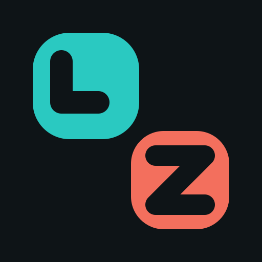
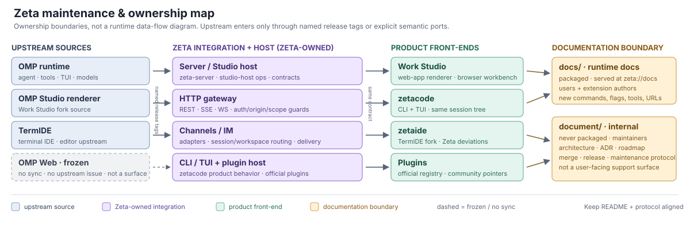

<p align="center">
  
</p>

<p align="center">
  <a href="https://github.com/Linxira-OS/linxira-zeta/releases"></a>
  
  
  
  <a href="https://github.com/Linxira-OS/linxira-zeta/actions"></a>
</p>

**English** · [简体中文](#简体中文)

Zeta is an agent workspace suite: **Work Studio**, the browser workbench served
by the CLI (`zetacode serve`), plus the tools behind it — a coding agent
(`zetacode`), a terminal IDE (`zetaide`), and the editor payload they share. It
is an **agent development environment (ADE)**, not an IDE with a chat pane: the
session is the unit of work and every panel is a surface the agent can use.
Linux is the primary platform; Windows x64 is supported; there is no macOS build.
There is no Rust desktop UI: the shipped desktop surface is the browser.

Zeta is a downstream fork of [OMP](https://github.com/can1357/oh-my-pi),
licensed MIT; we modify and extend the upstream tree rather than presenting it
as our own. Upstream copyright notices and the upstream MIT text are retained
in [`LICENSE`](./LICENSE); [`NOTICE`](./NOTICE) names the integrated upstream
release and Zeta's modifications. The sync ledger is
[`document/upstream-sync.md`](./document/upstream-sync.md). The pinned release
tag and status for every upstream we vendor or track are kept in
[`document/upstream-baselines.md`](./document/upstream-baselines.md).

## Built on

Three projects make Zeta possible, and we thank their authors and contributors.

| Project | What Zeta takes from it |
| ------- | ----------------------- |
| [OMP](https://github.com/can1357/oh-my-pi) (oh-my-pi), MIT | the runtime tree: agent, tools, TUI, model catalog, wire protocol |
| [OMP Studio](https://github.com/the-snowpear/omp-studio), MIT | the web UI: renderer, client, and the host contract it speaks |
| [TermIDE](https://github.com/termide/termide), MIT | `zetaide` and the built-in editor pane |

Two further upstreams shaped earlier work and stay credited: OMP Web (the origin
of the previous `web-ui/` snapshot) and Pi / Pi Web (the source of semantic
ports). Per-tree modification ledgers and the full fork declaration are in
[`THIRD-PARTY-NOTICES.txt`](./THIRD-PARTY-NOTICES.txt).

## Maintenance & ownership

Zeta is a downstream distribution with a deliberate boundary: upstream defects
follow upstream release process, while Zeta's product behavior, integration,
and usage differences are ours. The authoritative protocol — issue routing,
surface ownership, module map, and security channel — is
[`document/maintenance-ownership.md`](./document/maintenance-ownership.md).
Release-tag baselines are recorded in
[`document/upstream-baselines.md`](./document/upstream-baselines.md).



| Surface | Upstream | Maintained by |
| --- | --- | --- |
| `zetacode` runtime, CLI, TUI | [OMP](https://github.com/can1357/oh-my-pi), only through named official release tags | **Zeta core maintainers** for Zeta deltas; upstream for a clean upstream defect |
| Work Studio (`web-app/`), server/Studio host, `/api/v1/*` and Web Gateway | OMP Studio renderer fork; host, contracts, gateway, and fork integration are Zeta-owned | **Zeta server maintainers** |
| IM (`packages/channels/`, `packages/coding-agent/src/channels/`) | Zeta-originated channel runtime | **Zeta IM maintainers** |
| `zetaide` and the editor payload (`termide/`, `editor/`) | [TermIDE](https://github.com/termide/termide), vendored fork | **Zeta IDE maintainers** for fork deviations and branding |
| `desktop/`, `android/`, `main/` | Zeta-originated; paused or experimental lines | **Zeta core maintainers**; no new product work while paused |
| `plugins/`, `docs/`, `document/` | Zeta registry and documentation surfaces | **Zeta core maintainers** |
| `web-ui/` | Frozen OMP Web snapshot | No Zeta owner, no sync, not a product surface |

**Where to report:**

1. **Upstream defect** that reproduces without the Zeta overlay → the upstream
   project's issue tracker. Zeta consumes a fix only through the next **named
   official release tag**; never merge upstream `main` or a branch. OMP Studio
   `0.2.0` is currently untagged, so there is no `0.2.0` branch sync.
2. **Zeta feature, usage difference, or integration** → this repository's issue
   tracker, with the owning role above. Upstream should not be asked to own our
   product behavior.
3. **Security vulnerability** → the private advisory in
   [`.github/SECURITY.md`](./.github/SECURITY.md), never a public issue or pull
   request. IM and server findings are private-first.

`zetaide` and coding-agent additions made because of Zeta usage differences are
maintained by Zeta, not upstream.

### Runtime docs vs internal docs

- [`docs/`](./docs/) is **runtime documentation packaged with the product** and
  served at `zeta://docs`. It is for users, operators, and extension authors.
  Any new subcommand, flag, tool, config key, or internal URL surface must be
  documented here, not only in a CHANGELOG or code comment. Examples:
  [`docs/channels.md`](./docs/channels.md),
  [`docs/zeta-serve-web.md`](./docs/zeta-serve-web.md), and the
  [feature index](./docs/zeta-features.md).
- [`document/`](./document/) is **internal engineering documentation**, never
  packaged. It holds architecture, ADRs, roadmap, merge/release procedure, and
  this maintenance protocol. Examples:
  [`document/architecture-layers.md`](./document/architecture-layers.md),
  [`document/upstream-sync.md`](./document/upstream-sync.md), and
  [`document/maintenance-ownership.md`](./document/maintenance-ownership.md).
- Moving content between the trees requires cleaning every cross-reference;
  released CHANGELOG entries are immutable.

## The Suite

| Command    | Package           | What it is                                                       |
| ---------- | ----------------- | ---------------------------------------------------------------- |
| `zetacode` | `@linxiraos/zeta` | Coding agent CLI; `zetacode serve` opens **Work Studio**         |
| `zetaide`  | `@linxiraos/ide`  | Terminal IDE (TermIDE, vendored Rust)                            |

Every command launches standalone with its own `--help`. Work Studio is the
workbench: the page served by `zetacode serve` shares the CLI's runtime, host
contract (`/api/v1/*`) and settings, and hands coding/editing off to `zetacode`
and `zetaide` instead of re-implementing them. The `zetawork` / `zeta` bins still
exist in the paused `@linxiraos/main` package; the name is reserved for the
main/super-agent surface, and no Rust GUI ships under it (2026-11-06).

## Repository Map

The product has four layers and one rule: **the runtime depends on nothing
above it, and no front-end depends on another front-end.** The HTTP gateway is
an adapter, not the hub — it exists so a browser can talk to the runtime, not
because anything else needs it. `document/architecture-layers.md` is the full
contract; this is the orientation.

| Layer | Where | What it does |
| --- | --- | --- |
| Core runtime | `packages/coding-agent/src/` (+ `packages/agent`, `packages/ai`, `packages/tui`, `packages/channels`, `packages/stats`) | Sessions, tools, extensions/plugins, memory, skills, IRC/mesh. Runs in-process; no HTTP, no UI. |
| Host | `packages/coding-agent/src/server/` (`zeta-server.ts`), `packages/coding-agent/src/channels/` | Wires a session to its workspace, IM channels, the router, config and the default workspace. Nothing here serves HTTP. |
| Front-ends | `web-app/` (Work Studio, browser), `packages/coding-agent/src/commands/` (CLI/TUI), `termide/` (`zetaide`) | Each one is a client of the host. IM bots are a front-end too. |
| HTTP adapter | `packages/coding-agent/src/server/web-gateway/` | REST/SSE/WS over the host. `zetacode serve` starts it; the browser UI and remote phones consume it. |

Where each directory belongs:

| Path | Contents |
| --- | --- |
| `packages/` | The published runtime packages (`@linxiraos/*`): coding-agent, ai, agent, tui, catalog, stats, channels, wire, mnemopi, natives, utils, omptype, browser-relay. |
| `main/` | Paused Rust line (2026-11-05), its own Cargo workspace: the TUI (`crates/zeta-main`), the egui GUI (`crates/zetawork-gui`), `crates/sysmon`. Not a product surface; releases do not build it. |
| `termide/` | Vendored TermIDE panel library — the panels both workbenches embed — plus the `zetaide` entry (`@linxiraos/ide`). Deviations from the vendored snapshot are logged in `termide/VENDOR.md`. |
| `editor/` | The built-in editor pane's npm face. The payload is a `termide-editor` binary; the package declares no command. |
| `crates/` | Rust runtime crates compiled as native addons (`pi-natives`, `pi-ast`, `pi-diff`, `pi-builtins`, …), built by Bazel. |
| `web-app/` | **Work Studio**: the product renderer (Vite 7 + React), its own npm project. Ships inside `@linxiraos/zeta` at `dist/web-app`. |
| `web-ui/` | Frozen OMP Web snapshot (2026-11-05): not built, not published, no new features. |
| `desktop/` | Paused Electron shell. No new code; not part of any product surface. |
| `plugins/` | `official/` first-party plugins (source in-tree, `INDEX.md` registry) and `community/` pointer files. |
| `docs/` | Runtime documentation shipped with the product (`zeta://docs`). |
| `document/` | Internal engineering docs: architecture contracts, merge playbook, release mechanics, roadmap. Never packaged. |
| `scripts/` | Build, release, packaging and the mechanical guards CI runs. |
| `sdk/` | Protocol SDKs (`rust/`, `python/`, `go/`) for embedding the runtime. |
| `python/robomp/` | The containerised agent runner. |
| `infra/`, `bazel/`, `nix/`, `patches/`, `lsp/`, `skills/`, `assets/`, `types/` | Build infrastructure, toolchain files, patch set, LSP server table, bundled skills, image assets, ambient type shims. |

### Plugin layers

A plugin is TypeScript, but what it *shows* is a choice of layer. Pick by what
the surface needs, not by what the plugin is written in:

| Layer | Surface | Use it for |
| --- | --- | --- |
| Behaviour | Any front-end (tools, commands, hooks, messaging) | Work the agent performs. Rendered by nobody; identical in every client. |
| Panel | Not hosted yet | Work Studio does not render plugin panels today (no declarative-panel or HTML-page host in `web-app/`). A plugin that needs a surface reaches it through the agent's own tools. |

`zetaide` carries TermIDE's own upstream plugin layer from the 0.46 vendor bump,
separate from Zeta's plugin surface.

## Quick Start

Install the CLI and serve the workbench in your browser (Node 18+ or Bun):

```sh
npm i -g @linxiraos/zeta      # or: bun add -g @linxiraos/zeta
zetacode serve                # serves the Web UI on loopback
```

Work Studio ships inside that package: the renderer is staged at `dist/web-app`
and `ZETA_WEB_APP_DIR` overrides it for a custom build. `npm i -g @linxiraos/main`
still installs, but that Rust workbench is paused (2026-11-05); `zetacode serve`
is the supported entry point. Install the other tools standalone:

```sh
npm i -g @linxiraos/zeta      # zetacode — coding agent CLI
npm i -g @linxiraos/ide       # zetaide — terminal IDE
```

The editor is a workbench pane, not a standalone tool, so it has no install
line: `@linxiraos/editor` is a reserved package name whose payload is not
published today.

From a source checkout:

```sh
bun install
bun run build:native
bun run dev
```

## Work Studio (the browser workbench)

**Work Studio** is the browser workbench served by `zetacode serve` — one page,
one origin, no proxy:

- **Sessions first** — home, history, and the workbench are the same session
  tree; opening an old session or starting a new one does not switch runtimes.
- **Panels** — side and bottom panels (explorer, changes/diff, terminal over the
  gateway's PTY stream, media/artifacts, statistics, diagnostics, the agent hub)
  with remembered layout per scope.
- **Agents and approvals** — composer with model/mode pickers, queued messages,
  approval cards, tool bodies, and agent conversations in the same view.
- **One host contract** — every read and action goes through `/api/v1/*`
  (`docs/zeta-serve-web.md`), so the CLI, the browser and remote clients see the
  same capabilities; the capability manifest hides anything not implemented.
- **No Rust UI** — the old egui/WebView2 workbench (`main/crates/zetawork-gui`)
  is not a product surface; its design work lands in `web-app/src/studio/`.

## The Coding Agent

`zetacode` is the coding CLI (built on the OMP runtime):

- A terminal coding workspace with file reading, search, patching, shell, git,
  task delegation, and structured tool output.
- Multi-provider model access, local configuration, OAuth flows, model
  discovery, session recovery, and controllable retry behavior.
- A local web workbench (`zetacode serve` → Work Studio, `web-app/`) that embeds
  the same runtime — one session tree, one settings model, one host contract
  (`/api/v1/*`, with `/api/*` behind it).
- Native text, image, terminal, browser, and desktop capabilities where the
  host platform supports them.

## An agent development environment (ADE)

The suite is not an IDE with a chatbot bolted on. It is an **ADE — an Agent
Development Environment**, the way an IDE is an Integrated Development
Environment: the same structure, with the first word changed from *Integrated*
to *Agent*.

| | IDE | ADE (this suite) |
| --- | --- | --- |
| Center of gravity | the open file | the agent session |
| Who drives the tools | the editor drives LSP, builds, the debugger | the agent drives tools; editors and terminals are its work surfaces |
| Unit of work | a buffer | a session: context, tools, subagents, verification |
| Where the loop lives | type → build → debug | plan → execute → verify, with the human steering |

Zeta keeps the IDE's shape — panes, tabs, real PTYs, LSP, an editor pane, a
terminal IDE (`zetaide`) — because an agent needs somewhere to work. What moves
is the center: `zetacode` sessions, subagent orchestration, the mesh
(`agent://`), extensions and skills are first-class; the editor, terminals and
file manager are the environment the agent operates in. A human can still drive
any pane directly; the suite simply assumes the agent is the primary worker and
the panes are how it observes and changes the world.

## Origins

Zeta is built on two upstream projects:

| Project                                               | Role in Zeta                                                   |
| ----------------------------------------------------- | -------------------------------------------------------------- |
| [OMP (oh-my-pi)](https://github.com/can1357/oh-my-pi) | The runtime tree, integrated only at complete official releases |
| [Pi](https://github.com/earendil-works/pi)            | Semantic-port source for feature work, never a raw merge source |

Work Studio (`web-app/`) is a fork of OMP Studio that Zeta now maintains; its
host (`packages/coding-agent/src/server/studio-host/`) is Zeta's own. The Rust
workbench (`main/`) is paused. The old `web-ui/` renderer is an abandoned
third-party OMP Web snapshot, not a Zeta surface. Vendored
projects keep their own licences and are listed in [THIRD-PARTY-NOTICES.txt](THIRD-PARTY-NOTICES.txt); the merge
procedure is recorded in [document/upstream-sync.md](document/upstream-sync.md).

## Component Lineage

The distribution is assembled from parts with different origins. What a part
inherits from upstream — and what Zeta owns — is stated per component:

| Component                                                          | Origin                                 |
| ------------------------------------------------------------------ | -------------------------------------- |
| `web-app/` (Work Studio renderer)                                  | Zeta-maintained fork of OMP Studio (MIT) |
| `main/` (Rust workbench, paused; `@linxiraos/main`, bins `zetawork`/`zeta`) | Zeta-originated                |
| `packages/coding-agent/` (CLI, `zetacode`)                         | OMP runtime tree, release-tag merges   |
| `packages/ai`, `agent`, `catalog`, `tui`, `natives`, `utils`, `stats` | OMP runtime tree                     |
| `termide/` (TermIDE, `@linxiraos/ide`, binaries `zetaide`)         | [termide/termide](https://github.com/termide/termide), vendored fork (maintained here) |
| `web-ui/`                                                          | **Abandoned** third-party OMP Web snapshot (`17380936778/omp-web`); not built |
| `desktop/`                                                         | Zeta-originated, paused (Electron)     |
| `packages/coding-agent/src/channels/` (WeChat/Feishu/Telegram bridge) | Zeta-originated                     |
| `packages/coding-agent/src/server/` (web-gateway, `zetacode serve`) | Zeta-originated                       |

## Differences from Upstream

Attribution only means something if the boundary is explicit: upstream notices
cover upstream code, and Zeta's copyright covers what Zeta changed or added on
top. Per product surface:

### `zetacode` — coding agent and runtime (from OMP)

- **Upstream**: [OMP](https://github.com/can1357/oh-my-pi), merged whole at
  official release tags (currently `v18.16.0`): `packages/*`, `crates/*`, `sdk/*`,
  `python/*` and the TUI.
- **Zeta changes**: product identity (`.zeta`, `zetacode`, `zeta://`,
  `@linxiraos/*`, `zeta-cli-*` assets, frozen splash art); internal `__zeta*`
  markers; read-compatibility for legacy `OMP_*` variables and `.omp-plugin`;
  foreign project-config sources gated behind explicit consent; tool exposure
  tiers; telemetry hard-off; Zeta service ports.
- **Zeta features on top of the runtime** (each documented in `docs/`):
  `zetacode serve` and the Web Gateway REST surface backing Work Studio
  ([serve](./docs/zeta-serve-web.md), [gateway API](./docs/web-ui/api.md));
  ultra plan mode with fan-out scouting and incremental plan writes
  ([plan approval](./docs/plan-approval.md)); cross-session project tracking
  ([tracking](./docs/zeta-tracking.md));
  the channel runtime ([channels](./docs/channels.md)); agent hub and mesh
  ([hub](./docs/agent-hub.md), [mesh](./docs/agent-mesh.md)); the plugin
  registry ([plugins](./docs/plugins.md)); usage/statistics dashboards; windowed
  transcript pagination; precompressed static assets. The maintained index of
  these surfaces is [docs/zeta-features.md](./docs/zeta-features.md).
- **Maintained by**: Zeta. Upstream arrives only as complete release-tag merges;
  every Zeta delta is a separate commit (see `document/upstream-sync.md`).

### `zetaide` — terminal IDE (from TermIDE)

- **Upstream**: `termide/termide` tag `0.49.0`
  (`057eb55e0a7c4ee969982fab62dc83bde028e052`), vendored under `termide/` and
  shipped as the `zetaide` command (`@linxiraos/ide`).
- **Zeta changes**: the fork, the `zetaide` command and npm packaging, editor
  payload handling, theme and brand adaptation; deviations are listed in
  `termide/VENDOR.md`.
- **Maintained by**: Zeta for this fork. Changes land here, not upstream.

### Work Studio — browser workbench (from OMP Studio)

- **Upstream**: OMP Studio `0.1.17` renderer (`apps/renderer/src`), MIT,
  [`the-snowpear/omp-studio`](https://github.com/the-snowpear/omp-studio).
- **Zeta changes**: the renderer is a maintained fork in `web-app/` (its own Vite
  project); the host was reimplemented as `studio-host` (`/api/v1/*` pair, CSRF,
  query, command, events) rather than upstream's server; the client/protocol
  surface is vendored; identity was rebranded (Zeta links, fixtures,
  `zeta-studio` wire protocol); Zeta adds windowed transcript pagination,
  precompressed static serving, the real plugin registry and the usage
  dashboard.
- **Maintained by**: Zeta. The fork is where changes land; the upstream project
  receives nothing from us and is not followed automatically.

### `web-ui/` — abandoned third-party snapshot

- **Origin**: OMP Web ([`17380936778/omp-web`](https://github.com/17380936778/omp-web)),
  a third-party UI, not maintained by Zeta.
- **Status**: **abandoned** (2026-11-05). Kept only as a frozen snapshot for
  reference; not built, not shipped, receives no features or fixes, and is not a
  Zeta support surface. Work Studio supersedes it.

### `zetawork` — Rust workbench (Zeta-originated, paused)

- **Origin**: Zeta's own Rust TUI/GUI line (`main/`), paused 2026-11-05; its npm
  packages ship only by explicit dispatch. AGPL-3.0-only.

## Zeta-Originated Capabilities

Beyond the OMP runtime lineage, Zeta ships its own capabilities (roadmap in
[document/roadmap.md](document/roadmap.md)):

- **Work Studio** (`web-app/`) — the browser workbench: session history and
  workbench panels, a PTY terminal, diffs, artifact/media views, statistics and
  the agent hub, served by `zetacode serve` from the packaged `dist/web-app`;
  its host (`studio-host`, `/api/v1/*`) is Zeta's own.
- **Web gateway** — the `/api/*` REST surface behind the browser, one handler
  module per resource, consumed by Work Studio and remote clients.
- **Project tracking** — an opt-in cross-session record in `.zeta/tracking/`
  (progress, decisions, actions, plans) written through `tracking_update`; see
  [docs/zeta-tracking.md](./docs/zeta-tracking.md).
- **Taste layer** — per-prompt preference candidates with calibrated judgment
  and a capped system-prompt injection; see
  [docs/memory.md](./docs/memory.md#taste-layer).
- **Ultra plan mode** — `/plan-ultra` adds fan-out scouting and incremental
  plan writes to plan mode; see [docs/plan-approval.md](./docs/plan-approval.md).
- **Channel runtime** — WeChat/Feishu/Telegram bridges embedded in
  `zetacode serve`, with plan-image routing and workspace-scoped execution tools.
- **Usage and statistics extensions** — `/api/usage/daily` and the `usage.*`
  host operations feed the Work Studio dashboards; the upstream stats database
  and `zetacode stats` dashboard remain the base.
- **Linux downstream packaging** — the desktop archives (`zeta-desktop`,
  AppImage, Arch) keep their frozen name/digest contract but are **dispatch-only**
  since the 2026-11-05 pause, so no release publishes them; see
  `document/release.md`.
- **Inherited upstream capabilities** (not Zeta-originated): the `autoresearch`
  experiment loop, custom tools and TypeScript commands, the slash-command
  marketplace, and ACP support ship here with brand adaptations — see
  [docs/custom-tools.md](./docs/custom-tools.md),
  [docs/marketplace.md](./docs/marketplace.md),
  [docs/slash-command-internals.md](./docs/slash-command-internals.md).

## Related repositories

- [Linxira Knowledge Base (`lkb`)](https://github.com/Linxira-OS/linxira-knowledge-base)
  — the sibling self-hosted, layered knowledge base. It exposes an MCP server
  and an OpenAPI 3.1 surface, so a Zeta agent can query it as an external tool.
  It is a separate product with its own release line: not bundled with Zeta and
  not a build dependency. The client boundary — delegated identity, retrieval,
  maintenance scopes, audit attribution, and write approval — is recorded in
  [`document/lkb-integration.md`](./document/lkb-integration.md).

## Documentation

The repository keeps two documentation trees with different audiences:

- [docs/](docs/) — **runtime documentation**, packaged with the product. Agents
  read it at runtime through `zeta://docs/` (embedded in binaries and the npm
  bundle; from a source checkout it reads the live tree). Covers tools,
  tool-call conversion, skills, protocols, configuration, and Zeta features.
- [document/](document/) — **internal development and product-process
  documentation**, never packaged. Includes the [development
  roadmap](document/roadmap.md), the upstream [sync
  ledger](document/upstream-sync.md), and the
  [porting guide](document/porting-from-pi-mono.md).

## Interface Language

The CLI ships Simplified Chinese and English catalogues. The active language
resolves in this order:

1. `language` in the settings file (`~/.zeta/settings.json`) — the explicit
   choice, written by `/language`.
2. `ZETA_LANG` / `LC_ALL` / `LC_MESSAGES` / `LANG` — the shell locale.
3. The OS UI language (`Intl`) — so a Chinese Windows box gets Chinese with no
   configuration at all.
4. English when nothing matches.

`/language` switches live: slash-command descriptions, the composer, and every
localized panel re-resolve on the next render without a restart. Both
catalogues are complete, so the choice is per-install rather than per-build —
plugins can register their own text through the same source.

## Development

```sh
# Static checks for TypeScript and Rust
bun check

# Coding-agent checks only
bun --cwd=packages/coding-agent run check

# Focused tests
bun --cwd=packages/coding-agent test test/<file>.test.ts
```

### Coverage

There is no coverage threshold yet. The first measured baseline (2026-11-03,
local Windows, one-off LCOV run) is:

| Package             | Line coverage | Function coverage | Source files reached |
| ------------------- | ------------: | ----------------: | -------------------: |
| `packages/agent`    |         88.0% |             83.5% |                 100% |
| `packages/ai`       |         89.9% |             92.3% |                98.3% |
| `packages/catalog`  |         93.8% |             63.4% |                94.9% |
| `packages/tui`      |         73.3% |             77.5% |                90.3% |
| `packages/utils`    |         78.7% |             75.1% |                97.0% |
| `coding-agent` core |         29.7% |             23.2% |                66.7% |

The five support packages combined are at **81.2% lines / 79.7% functions**.
`coding-agent` shows a **core sample** only (`test/session`,
`test/session-manager`, `test/config`, `test/core`; 1,003 tests): the full
2,113-file suite did not finish within 40 minutes under coverage instrumentation.
Do not read 29.7% as the whole package.

Bun's LCOV only includes source files a test actually loaded, so these numbers
are **loaded-file coverage**, not whole-repository coverage. Files never imported
are absent from the denominator; the “source files reached” column is the
counterweight. Linux CI numbers differ slightly from this Windows baseline.

Generate the same report locally:

```sh
cd packages/ai
bun test --coverage --coverage-reporter=lcov --coverage-dir=../../coverage/ai
```

Maintainers and contributors must run the **Coverage** GitHub Actions workflow
before a release or a coverage-sensitive merge, and attach its LCOV artifact to
the review/release record. The policy, current gaps, and ratchet rules are in
[`.github/MAINTAINERS.md`](.github/MAINTAINERS.md). Coverage is evidence, not a
substitute for exercising the changed behavior.

The primary application lives in `packages/coding-agent/`. Shared runtime
packages include `packages/ai/`, `packages/catalog/`, `packages/agent/`,
`packages/tui/`, and `packages/natives/`. The browser renderer lives in
`web-app/` (its own npm project); the paused Rust workbench lives in `main/`,
and the vendored TermIDE tree under `termide/`.

## Platform Support

Linux is the primary platform (Linxira OS, Arch-based); Windows x64 is a
supported development/target platform; macOS is not built.

| Surface                              | Linux      | Windows | macOS |
| ------------------------------------ | ---------- | ------- | ----- |
| `zetacode` CLI                         | x64, arm64 | x64     | —     |
| `zetaide` (`@linxiraos/ide`)        | x64        | x64     | —     |
| Work Studio (`zetacode serve`, ships in `@linxiraos/zeta`) | x64, arm64 | x64 | — |

Native text/grep and image capabilities require the platform C/C++ toolchain
when built from source; released binaries bundle the prebuilt native modules.

## Upstream Policy

Zeta follows OMP only through complete, official release tags. Each release is
merged as real Git history on a temporary integration branch, then receives any
required Zeta package, brand, Bun, CI, and product adaptations in separate
commits. The exact source tag, SHA, conflict decisions, and checks are recorded
in [document/upstream-sync.md](document/upstream-sync.md).

Pi is a semantic feature source, not a raw merge source. See
[AGENTS.md](AGENTS.md) for the repository rules.

### Commercial surfaces

Upstream ships commercial surfaces: the Stencil build service, a hosted model
catalog, the hosted `/share` viewer, its Homebrew tap, and OTLP telemetry.
Zeta runs none of them. The build service and telemetry are not in this tree;
every hosted endpoint the code still references is pinned in
[document/upstream-commercial-assets.md](document/upstream-commercial-assets.md)
with its replacement status, and `bun scripts/check-shared-infra.ts` fails when
an unregistered upstream endpoint appears.


## License

Zeta carries two licences, split by path:

| Path                                                                     | Licence                                   |
| ------------------------------------------------------------------------ | ----------------------------------------- |
| `main/` — the paused Rust workbench (`zetawork`, `zeta`, and its npm packages) | **AGPL-3.0-only** ([text](main/LICENSE)) |
| `packages/`, `crates/`, `sdk/`, `web-ui/`, `desktop/`, `docs/`, `document/`, `scripts/` | **MIT**                    |
| `termide/`, `editor/` — vendored TermIDE                                  | **MIT** ([text](termide/LICENSE))        |

The root [LICENSE](LICENSE) states the split and reproduces the MIT text that
governs everything outside `main/`. Derived and vendored projects keep their own
licences and are listed in [THIRD-PARTY-NOTICES.txt](THIRD-PARTY-NOTICES.txt).

Zeta's copyright lines mark Zeta's modifications and additions only; the
upstream notices and licence texts remain in force for the upstream portions.
The per-surface boundary — what came from OMP, TermIDE and OMP Studio, what Zeta
changed, and which trees are abandoned — is stated under
[Differences from Upstream](#differences-from-upstream). In particular, `web-ui/`
is an abandoned third-party snapshot: it is not a Zeta-maintained surface, and
Zeta's additions to it are limited to the frozen snapshot as received.

Commercial licensing of the Rust workbench is available by arrangement with the
maintainers.

Work Studio's editor is built in: `@linxiraos/editor` is the reserved package
name for its binary payload (the earlier TTT-derived Go payload was removed
2026-10-16 and stays credited in source history).

## 简体中文

Zeta 是一套 agent 工作区套件：**Work Studio**（由 CLI `zetacode serve` 托管的
浏览器工作台），加上它背后的工具——编码 Agent（`zetacode`）、终端 IDE
（`zetaide`），以及两者共用的编辑器载荷。它是 **Agent 开发环境（ADE）**，
不是"IDE 加聊天框"：会话是工作单元，每个面板都是 agent 可以使用的工作面。
Linux 是主力平台；支持 Windows x64；不提供 macOS 构建。**不存在 Rust 桌面 UI**：
出货的桌面面就是浏览器。

### 基础上游（致谢）

三个项目使 Zeta 成为可能，感谢它们的作者与贡献者。

| 项目 | Zeta 取自它的部分 |
| --- | --- |
| [OMP](https://github.com/can1357/oh-my-pi)（oh-my-pi），MIT | 运行时树：agent、工具、TUI、模型 catalog、wire 协议 |
| [OMP Studio](https://github.com/the-snowpear/omp-studio)，MIT | Web UI：renderer、client 及其 host 契约 |
| [TermIDE](https://github.com/termide/termide)，MIT | `zetaide` 与内置编辑器面板 |

另外两个上游塑造了更早的工作并仍在致谢之列：OMP Web（上一版 `web-ui/` 快照的来源）、
Pi / Pi Web（语义移植来源）。逐树改动账目与完整 fork 声明见
[`THIRD-PARTY-NOTICES.txt`](./THIRD-PARTY-NOTICES.txt)。

### 目录与分层

产品分四层，依赖单向：核心运行时 → Host → 前端 → HTTP 适配器。HTTP 只是适配器，
不是中枢；浏览器 UI 和远程手机是它的消费者，其它前端不依赖它
（完整契约见 `document/architecture-layers.md`）。

| 路径 | 是什么 |
| --- | --- |
| `packages/` | 运行时包（`@linxiraos/*`）：coding-agent、ai、agent、tui、catalog、stats、channels、wire、mnemopi、natives 等 |
| `main/` | 暂停的 Rust 线（2026-11-05）：TUI（`crates/zeta-main`）、egui GUI（`crates/zetawork-gui`）、共享采样（`crates/sysmon`）。不是产品面，release 不构建 |
| `termide/` | vendored TermIDE 面板库 + `zetaide`；对快照的偏离登记在 `termide/VENDOR.md` |
| `editor/` | 内置编辑器面板的 npm 面（载荷是 `termide-editor` 二进制，不声明命令） |
| `crates/` | 原生 Rust 运行时 crate（`pi-natives` 等），由 Bazel 构建 |
| `web-app/` | **Work Studio**：产品渲染器（Vite 7 + React），独立 npm 工程；随 `@linxiraos/zeta` 出货到 `dist/web-app` |
| `web-ui/` | 冻结的 OMP Web 快照（2026-11-05）：不构建、不发布、不加功能 |
| `desktop/` | 暂停的 Electron 壳：不新增代码，不属于任何产品面 |
| `plugins/` | `official/`（第一方插件源码 + `INDEX.md` 登记）与 `community/`（指针文件） |
| `docs/` | 随产品打包的运行时文档（`zeta://docs`）；`document/` 是内部工程文档，不打包 |
| `scripts/` | 构建、发布、打包与 CI 守卫 |
| `sdk/`、`python/robomp/` | 协议 SDK（rust/python/go）、容器化 Agent 运行器 |

插件按"要显示在哪个面"选，而不是按插件用什么语言写：**行为**（工具/命令/钩子，
所有前端一致）。**面板宿主尚不存在**：Work Studio 今天不渲染插件面板（`web-app/`
里没有声明式面板或 HTML 页宿主），需要界面的插件走 agent 自己的工具。`zetaide`
的插件层来自 TermIDE 上游，与 Zeta 插件面分离。

### 套件

| 命令       | 包                  | 是什么                                          |
| ---------- | ------------------- | ----------------------------------------------- |
| `zetacode` | `@linxiraos/zeta`   | 编码 Agent CLI；`zetacode serve` 打开 **Work Studio** |
| `zetaide`  | `@linxiraos/ide`    | 终端 IDE（TermIDE，vendored Rust）              |

每条命令都能独立启动、各有自己的 `--help`。Work Studio 就是工作台：`zetacode serve`
服务的页面与 CLI 共用运行时、宿主契约（`/api/v1/*`）和设置，编码/编辑交给
`zetacode` 与 `zetaide`，不另做一套。`zetawork` / `zeta` 这两个 bin 仍在暂停的
`@linxiraos/main` 包里；名字保留给 main/super-agent 面，**没有 Rust GUI 随它出货**
（2026-11-06）。

### 快速开始

安装 CLI 并在浏览器里打开工作台（机器上需有 Node 18+ 或 Bun）：

```sh
npm i -g @linxiraos/zeta      # 或:bun add -g @linxiraos/zeta
zetacode serve                # 在 loopback 上服务 Work Studio
```

Work Studio 就在这个包里：渲染器随包放在 `dist/web-app`，自定义构建用
`ZETA_WEB_APP_DIR` 覆盖。`npm i -g @linxiraos/main` 仍可安装，但那个 Rust
工作台已暂停（2026-11-05）；`zetacode serve` 是受支持的入口。其它工具独立安装：

```sh
npm i -g @linxiraos/zeta      # zetacode — 编码 Agent CLI
npm i -g @linxiraos/ide       # zetaide — 终端 IDE
```

编辑器是工作区里的内置面板,不是独立工具,因此没有安装行:`@linxiraos/editor`
是预留包名,其载荷当前不发布。

从源码检出运行:

```sh
bun install
bun run build:native
bun run dev
```

### Work Studio（浏览器工作台）

**Work Studio** 是 `zetacode serve` 服务的浏览器工作台——一个页面、一个源，没有代理：

- **会话优先** —— 首页、历史、工作台是同一棵会话树；打开旧会话或新建会话
  不切换运行时。
- **面板** —— 侧栏与底栏（资源管理器、变更/diff、走网关 PTY 流的终端、
  媒体/产物、统计、诊断、Agent Hub），布局按作用域记忆。
- **Agent 与审批** —— 带模型/模式选择器的输入框、排队消息、审批卡、工具体、
  agent 会话都在同一视图里。
- **单一宿主契约** —— 所有读取与动作都走 `/api/v1/*`（`docs/zeta-serve-web.md`），
  CLI、浏览器、远程客户端看到同一份能力清单；未实现的操作不出现在清单里。
- **没有 Rust UI** —— 旧的 egui/WebView2 工作台（`main/crates/zetawork-gui`）不是
  产品面；它的设计工作落在 `web-app/src/studio/`。

### 编码 Agent

`zetacode` 是编码 CLI(基于 OMP 运行时构建):

- 终端编码工作区,包含文件读取、搜索、补丁、shell、git、任务委派和结构化
  工具输出。
- 多提供商模型访问、本地配置、OAuth 流程、模型发现、会话恢复和可控的重试
  行为。
- 本地 Web 工作台(`zetacode serve` → Work Studio,`web-app/`)嵌入同一运行时——
  同一会话树、同一设置模型、同一宿主契约(`/api/v1/*`,`/api/*` 在其后)。
- 宿主平台支持时提供原生文本、图像、终端、浏览器和桌面能力。

### Agent 开发环境（ADE）

这套件不是"IDE 加个聊天框",而是 **ADE——Agent Development Environment
(Agent 开发环境)**;它与 IDE(Integrated Development Environment,集成开发
环境)结构相同,只把第一个词从 *Integrated* 换成 *Agent*。

| | IDE | ADE(本套件) |
| --- | --- | --- |
| 重心 | 打开的文件 | agent 会话 |
| 谁驱动工具 | 编辑器驱动 LSP、构建、调试器 | agent 驱动工具;编辑器与终端是它的工作面 |
| 工作单元 | 一个缓冲区 | 一次会话:上下文、工具、子代理、验证 |
| 循环在哪 | 写 → 构建 → 调试 | 规划 → 执行 → 验证,人负责掌舵 |

Zeta 保留 IDE 的形态——窗格、标签页、真实 PTY、LSP、编辑器面板、终端 IDE
(`zetaide`)——因为 agent 需要一个工作的地方。移动的是中心:`zetacode` 会话、
子代理编排、mesh(`agent://`)、扩展与技能都是一等公民;编辑器、终端和文件
管理器是 agent 操作的环境。人仍然可以直接驱动任何窗格;套件只是假定 agent
是主要工作者,窗格是它观察和改变世界的方式。

### 上游来源

Zeta 基于两个上游项目:

| 项目                                                  | 在 Zeta 中的角色                          |
| ----------------------------------------------------- | ----------------------------------------- |
| [OMP (oh-my-pi)](https://github.com/can1357/oh-my-pi) | 运行时树,只在完整官方发布上合并           |
| [Pi](https://github.com/earendil-works/pi)            | 功能工作的语义移植来源,绝不作为原始合并源 |

Work Studio(`web-app/`)是 Zeta 接手的 OMP Studio 分支，其宿主
(`packages/coding-agent/src/server/studio-host/`)是我们自己的实现；Rust 工作台
(`main/`)已暂停；旧的 `web-ui/` 是**已放弃维护**的第三方 OMP Web 快照，不是 Zeta
的产品面。vendored 项目保持各自的许可,
列在 [THIRD-PARTY-NOTICES.txt](THIRD-PARTY-NOTICES.txt);合并流程记录在
[document/upstream-sync.md](document/upstream-sync.md)。

### 维护与归属

Zeta 是下游发行版，边界是刻意的：上游缺陷走上游发布流程；Zeta 的产品行为、
集成和使用差异由 Zeta 负责。权威协议——问题路由、产品面归属、模块地图和安全
通道——见 [`document/maintenance-ownership.md`](./document/maintenance-ownership.md)，
发布 tag 基线见 [`document/upstream-baselines.md`](./document/upstream-baselines.md)。


| 产品面 | 上游 | 维护者 |
| --- | --- | --- |
| `zetacode` 运行时、CLI、TUI | [OMP](https://github.com/can1357/oh-my-pi)，只通过点名的官方 release tag | Zeta 差异由 **Zeta core maintainers** 维护；干净的上游缺陷走上游 |
| Work Studio（`web-app/`）、server/Studio host、`/api/v1/*` 与 Web Gateway | OMP Studio 渲染器分支；宿主、契约、网关和分支集成归 Zeta | **Zeta server maintainers** |
| IM（`packages/channels/`、`packages/coding-agent/src/channels/`） | Zeta 原创的频道运行时 | **Zeta IM maintainers** |
| `zetaide` 与编辑器载荷（`termide/`、`editor/`） | [TermIDE](https://github.com/termide/termide)，vendored 分支 | 分支差异与品牌由 **Zeta IDE maintainers** 维护 |
| `desktop/`、`android/`、`main/` | Zeta 原创；暂停或实验线 | **Zeta core maintainers**；暂停期间不新增产品工作 |
| `plugins/`、`docs/`、`document/` | Zeta 插件注册表与文档面 | **Zeta core maintainers** |
| `web-ui/` | 冻结的 OMP Web 快照 | 无 Zeta 维护者、无同步、不是产品面 |

**报告路径：**

1. **上游缺陷**：在不带 Zeta 覆盖层时也能复现 → 上游项目 issue。Zeta 只通过下一个
   **点名的官方 release tag** 接收修复；绝不合并上游 `main` 或分支。OMP Studio
   `0.2.0` 当前没有 tag，因此不存在 `0.2.0` 分支同步。
2. **Zeta 功能、使用差异或集成问题** → 本仓库 issue，并按上表找对应维护角色。
   不应要求上游接管我们的产品行为或使用差异。
3. **安全漏洞** → [`.github/SECURITY.md`](./.github/SECURITY.md) 中的私有 advisory，
   绝不走公开 issue 或 pull request。IM 与 server 问题一律私有优先。

`zetaide` 与因 Zeta 使用差异新增的 coding-agent 行为由 Zeta 维护，不由上游维护。

#### 运行时文档与内部文档

- [`docs/`](./docs/) 是**随产品打包的运行时文档**，通过 `zeta://docs` 提供，面向
  用户、运维和扩展作者。新的子命令、标志、工具、配置键或内部 URL 面必须写在这里，
  不能只留 CHANGELOG 或代码注释。例子：
  [`docs/channels.md`](./docs/channels.md)、
  [`docs/zeta-serve-web.md`](./docs/zeta-serve-web.md)、
  [功能索引](./docs/zeta-features.md)。
- [`document/`](./document/) 是**内部工程文档，永不打包**。放架构、ADR、路线图、
  合并/release 流程和维护协议。例子：
  [`document/architecture-layers.md`](./document/architecture-layers.md)、
  [`document/upstream-sync.md`](./document/upstream-sync.md)、
  [`document/maintenance-ownership.md`](./document/maintenance-ownership.md)。
- 在 `docs/` 与 `document/` 之间移动内容要清理所有交叉引用；已发布 CHANGELOG
  条目不可变。

### 组件谱系

该发行版由不同来源的部件组装而成。每个部件继承了什么、Zeta 拥有什么,
逐组件说明:

| 组件                                                              | 来源                                   |
| ----------------------------------------------------------------- | -------------------------------------- |
| `web-app/`（Work Studio 渲染器）                                  | Zeta 维护的 OMP Studio 分支（MIT）     |
| `main/`（Rust 工作台，已暂停；`@linxiraos/main`，二进制 `zetawork`/`zeta`） | Zeta 原创                    |
| `packages/coding-agent/`(CLI,`zetacode`)                          | OMP 运行时树,按发布 tag 合并           |
| `packages/ai`、`agent`、`catalog`、`tui`、`natives`、`utils`、`stats` | OMP 运行时树                       |
| `termide/`(TermIDE,`@linxiraos/ide`,二进制 `zetaide`)             | [termide/termide](https://github.com/termide/termide)，vendored 分支（此处维护） |
| `web-ui/`                                                         | **已放弃维护**的第三方 OMP Web 快照（`17380936778/omp-web`）；不构建 |
| `desktop/`                                                        | Zeta 原创，已暂停（Electron）          |
| `packages/coding-agent/src/channels/`(微信/飞书/Telegram 桥接)    | Zeta 原创                              |
| `packages/coding-agent/src/server/`(web-gateway,`zetacode serve`) | Zeta 原创                              |

### 与上游的差异

归属声明只有在边界清楚时才有意义：上游版权声明覆盖上游代码，Zeta 的版权只覆盖
Zeta 修改与新增的部分。按产品面说明：

#### `zetacode` — 编码 Agent 与运行时（源自 OMP）

- **上游**：[OMP](https://github.com/can1357/oh-my-pi)，只在官方发布 tag 上整树合并（当前 `v18.16.0`）：
  `packages/*`、`crates/*`、`sdk/*`、`python/*` 与 TUI。
- **Zeta 的改动**：产品身份（`.zeta`、`zetacode`、`zeta://`、`@linxiraos/*`、
  `zeta-cli-*` 资产名、冻结的启动字符画）；内部 `__zeta*` 记号；旧 `OMP_*` 变量与
  `.omp-plugin` 的读取兼容；外来项目配置来源需显式同意；工具暴露档位；遥测硬关闭；
  Zeta 服务端口。
- **运行时之上的 Zeta 功能**（均在 `docs/` 有文档）：`zetacode serve` 与支撑
  Work Studio 的 Web Gateway REST 面（[serve](./docs/zeta-serve-web.md)、
  [gateway API](./docs/web-ui/api.md)）；ultra plan（fan-out 侦察与增量写计划，
  [plan approval](./docs/plan-approval.md)）；跨会话项目 tracking
  （[tracking](./docs/zeta-tracking.md)）；频道运行时
  （[channels](./docs/channels.md)）；agent hub 与 mesh
  （[hub](./docs/agent-hub.md)、[mesh](./docs/agent-mesh.md)）；插件注册表
  （[plugins](./docs/plugins.md)）；用量/统计面板；转录分页；静态资源预压缩。
  这些产品面的维护索引是 [docs/zeta-features.md](./docs/zeta-features.md)。
- **谁维护**：Zeta。上游只以完整 release tag 合并进入，Zeta 的差异全部是独立提交
  （见 `document/upstream-sync.md`）。

#### `zetaide` — 终端 IDE（源自 TermIDE）

- **上游**：`termide/termide` tag `0.49.0`
  （`057eb55e0a7c4ee969982fab62dc83bde028e052`），vendored 在 `termide/`，以 `zetaide`
  命令（`@linxiraos/ide`）发布。
- **Zeta 的改动**：本分支、`zetaide` 命令与 npm 打包、编辑器载荷处理、主题与品牌适配；
  逐条差异见 `termide/VENDOR.md`。
- **谁维护**：该分支由 Zeta 维护；改动落在这里，不回推上游。

#### Work Studio — 浏览器工作台（源自 OMP Studio）

- **上游**：OMP Studio `0.1.17` 渲染器（`apps/renderer/src`），MIT，
  [`the-snowpear/omp-studio`](https://github.com/the-snowpear/omp-studio)。
- **Zeta 的改动**：渲染器是 `web-app/` 中由 Zeta 维护的分支（独立 Vite 工程）；宿主
  重写为 `studio-host`（`/api/v1/*` 的 pair、CSRF、query、command、events），不再使用
  上游服务端；client/protocol 面 vendored；品牌收口（Zeta 链接与夹具、`zeta-studio`
  线协议）；Zeta 新增转录分页、静态资源预压缩、真实插件注册表与用量面板。
- **谁维护**：Zeta。改动落在这个分支；不向上游提交，也不自动跟随上游。

#### `web-ui/` — 已放弃维护的第三方快照

- **来源**：OMP Web（[`17380936778/omp-web`](https://github.com/17380936778/omp-web)），
  第三方 UI，不由 Zeta 维护。
- **状态**：**已放弃维护**（2026-11-05）。只作为冻结快照保存供参考；不构建、不出货、
  不接收功能或修复，不属于 Zeta 支持面。产品面由 Work Studio 取代。

#### `zetawork` — Rust 工作台（Zeta 原创，已暂停）

- **来源**：Zeta 自己的 Rust TUI/GUI 线（`main/`），2026-11-05 暂停；其 npm 包只在
  显式 dispatch 时发布。AGPL-3.0-only。

### Zeta 自有能力

除 OMP 运行时谱系之外,Zeta 还提供自己的能力(路线图见
[document/roadmap.md](document/roadmap.md)):

- **Work Studio**(`web-app/`)—— 浏览器工作台:会话历史与工作台面板、PTY 终端、
  diff、产物/媒体视图、统计与 Agent Hub,由 `zetacode serve` 从随包的
  `dist/web-app` 提供;其宿主(`studio-host`,`/api/v1/*`)是 Zeta 自己的实现。
- **Web 网关** —— 浏览器背后的 `/api/*` REST 面,每个资源一个处理模块,由
  Work Studio 与远程客户端消费。
- **项目 tracking** —— `.zeta/tracking/` 里可选的跨会话记录(进度、决策、动作、
  计划),通过 `tracking_update` 写入;见 [docs/zeta-tracking.md](./docs/zeta-tracking.md)。
- **Taste 层** —— 每个提示抽取偏好候选,带校准判断与有上限的系统提示注入;
  见 [docs/memory.md](./docs/memory.md#taste-layer)。
- **Ultra plan** —— `/plan-ultra` 在 plan mode 上增加 fan-out 侦察与增量写计划;
  见 [docs/plan-approval.md](./docs/plan-approval.md)。
- **通道运行时** —— 嵌入 `zetacode serve` 的微信/飞书/Telegram 桥接,带
  plan-image 路由和工作区作用域的执行工具。
- **用量与统计扩展** —— `/api/usage/daily` 与 `usage.*` 宿主操作供给 Work Studio
  面板;上游的 stats 数据库与 `zetacode stats` 仪表板仍是底座。
- **Linux 下游打包** —— 桌面归档(`zeta-desktop`、AppImage、Arch)保留冻结的
  名称/摘要契约,但自 2026-11-05 暂停起**只能手动 dispatch**,release 不再
  发布它们;见 `document/release.md`。
- **继承自上游**(非 Zeta 原创):`autoresearch` 实验循环、自定义工具与
  TypeScript 命令、斜杠命令市场、ACP 支持,在本仓库带品牌适配出货——见
  [docs/custom-tools.md](./docs/custom-tools.md)、
  [docs/marketplace.md](./docs/marketplace.md)、
  [docs/slash-command-internals.md](./docs/slash-command-internals.md)。

### 相关仓库

- [Linxira Knowledge Base（`lkb`）](https://github.com/Linxira-OS/linxira-knowledge-base)
  —— 同组织的自托管分层知识库。它提供 MCP server 与 OpenAPI 3.1 接口，Zeta agent
  可作为外部工具查询。它是独立产品、有独立发布线：不随 Zeta 打包，也不是构建
  依赖。客户端边界（委派身份、检索、维护作用域、审计归因、写入审批）记录在
  [`document/lkb-integration.md`](./document/lkb-integration.md)。

### 文档

仓库保留两棵面向不同读者的文档树:

- [docs/](docs/) —— **运行时文档**,随产品打包。Agent 在运行时通过
  `zeta://docs/` 读取(内嵌于二进制和 npm 包;源码检出时读取实际目录)。
  涵盖工具、工具调用转换、技能、协议、配置和 Zeta 功能。
- [document/](document/) —— **内部开发与产品流程文档**,绝不打包。包括
  [开发路线图](document/roadmap.md)、上游[同步台账](document/upstream-sync.md)
  和[移植指南](document/porting-from-pi-mono.md)。

### 界面语言

CLI 提供简体中文和英文两套目录。活动语言按以下顺序解析:

1. 设置文件中的 `language`(`~/.zeta/settings.json`)——显式选择,由
   `/language` 写入。
2. `ZETA_LANG` / `LC_ALL` / `LC_MESSAGES` / `LANG` —— shell 区域设置。
3. 操作系统 UI 语言(`Intl`)——因此中文 Windows 无需任何配置即显示中文。
4. 都不匹配时使用英文。

`/language` 即时切换:斜杠命令描述、输入框和每个本地化面板在下一次渲染时
重新解析,无需重启。两套目录都是完整的,因此该选择是按安装而非按构建——
插件可以通过同一来源注册自己的文本。

### 开发

```sh
# TypeScript 与 Rust 的静态检查
bun check

# 仅编码 Agent 检查
bun --cwd=packages/coding-agent run check

# 聚焦测试
bun --cwd=packages/coding-agent test test/<file>.test.ts
```

主应用位于 `packages/coding-agent/`。共享运行时包包括 `packages/ai/`、
`packages/catalog/`、`packages/agent/`、`packages/tui/` 和
`packages/natives/`。工作区在 `main/`(独立 Cargo workspace),vendored
树在 `termide/`。

### 平台支持

Linux 是主力平台(Linxira OS,基于 Arch);Windows x64 是受支持的开发与
目标平台;不构建 macOS。

| 形态                               | Linux      | Windows | macOS |
| ---------------------------------- | ---------- | ------- | ----- |
| `zetacode` CLI                       | x64, arm64 | x64     | —     |
| `zetaide`(`@linxiraos/ide`)       | x64        | x64     | —     |
| Work Studio(`zetacode serve`,随 `@linxiraos/zeta` 出货) | x64, arm64 | x64 | — |

从源码构建时,原生文本/grep 和图像能力需要平台 C/C++ 工具链;发布的二进制
内置预构建原生模块。

### 上游政策

Zeta 只通过完整、官方的发布 tag 跟随 OMP。每次发布都在临时集成分支上作真实
Git 历史合并,然后以独立提交加入所需的 Zeta 包、品牌、Bun、CI 和产品适配。
确切的来源 tag、SHA、冲突决策和检查记录在
[document/upstream-sync.md](document/upstream-sync.md)。

Pi 是语义功能来源,不是原始合并来源。仓库规则见
[AGENTS.md](AGENTS.md)。

### 商业面

上游随代码发布自己的商业面:Stencil 构建服务、托管模型目录、托管 `/share`
查看页、自家 Homebrew tap 与 OTLP 遥测。Zeta 一个都不运行:构建服务与遥测
不在本树内;代码仍引用的每个托管端点都钉在
[document/upstream-commercial-assets.md](document/upstream-commercial-assets.md)
并标注替代状态;出现未登记的上游端点时 `bun scripts/check-shared-infra.ts`
会直接失败。


### 许可证

Zeta 按路径承载两种许可:

| 路径                                                                  | 许可                                      |
| --------------------------------------------------------------------- | ----------------------------------------- |
| `main/` — 暂停的 Rust 工作台(`zetawork`、`zeta` 及其 npm 包)         | **AGPL-3.0-only**([全文](main/LICENSE))  |
| `packages/`、`crates/`、`sdk/`、`web-ui/`、`desktop/`、`docs/`、`document/`、`scripts/` | **MIT**          |
| `termide/`、`editor/` — vendored TermIDE                              | **MIT**([全文](termide/LICENSE))          |

根目录 [LICENSE](LICENSE) 说明分层,并复述管辖 `main/` 之外全部代码的 MIT 文本。
派生与 vendored 项目保持各自许可,列在 [THIRD-PARTY-NOTICES.txt](THIRD-PARTY-NOTICES.txt)。

Zeta 的版权行只标注 Zeta 的修改与新增；上游部分仍以上游版权声明与许可文本为准。
逐产品面的边界（哪些来自 OMP、TermIDE、OMP Studio，Zeta 改了什么，哪些树已放弃维护）
见 [与上游的差异](#与上游的差异)。其中 `web-ui/` 是**已放弃维护**的第三方快照：
它不是 Zeta 维护的产品面，Zeta 对它的改动仅限于接收时的冻结快照。

工作台的商业授权可与维护者协商。

工作区的编辑器是内置面板:`@linxiraos/editor` 是预留给该面板二进制载荷的包名
(早先由 [TTT Editor](https://github.com/eugenioenko/ttt) 派生的 Go 载荷已于
2026-10-16 移除,仍在源代码历史中获得致谢)。
