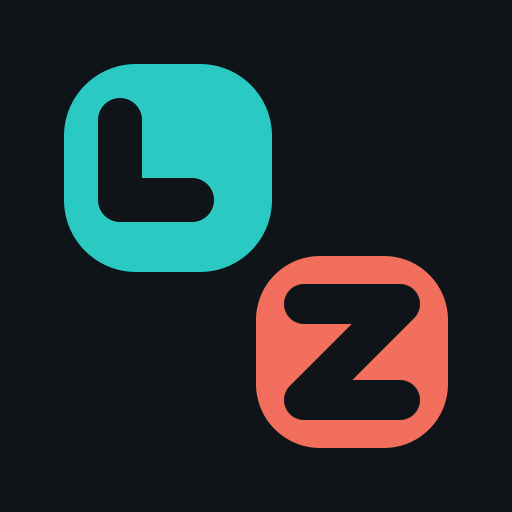

<p align="center">
  
</p>

<p align="center">
  <a href="https://github.com/Linxira-OS/linxira-zeta/releases"></a>
  
  
  
  <a href="https://github.com/Linxira-OS/linxira-zeta/actions"></a>
</p>

**English** · [简体中文](rep-docs/README.zh-CN.md)

Zeta is a **terminal-first** agent workspace: the coding agent (`zetacode`),
the terminal IDE (`zetaide`), and the TSP terminal surface are the primary
product. **Z Work Studio** (the browser workbench served by `zetacode serve`) is
an **optional preview**, not the recommended entry point: in practice it can
stutter or stall with multi-agent sessions, and some page/context reads are
unreliable. Its release is paused while the terminal/TSP surface becomes the
main path.

It is an **agent development environment (ADE)**, not an IDE with a chat pane:
the session is the unit of work, and every panel is a surface the agent can
use. Linux is the primary platform; Windows x64 is supported; macOS is not
built. There is no Rust desktop UI.

Zeta is a downstream fork of [OMP](https://github.com/Linxira-OS/linxira-zeta),
licensed MIT. The integrated runtime source is OMP **v18.22.0**. Z Work Studio
is a maintained fork of
[OMP Studio](https://github.com/the-snowpear/omp-studio); **v0.2.4** renderer
and shared packages are integrated through a Zeta Host adapter without
downgrading OMP. The 14/14 Studio final gate and the full release CI run passed.
`zetaide` vendors [TermIDE](https://github.com/termide/termide) **0.49.0**.
Upstream copyright notices and licence texts remain in [`LICENSE`](./LICENSE)
and [`NOTICE`](./NOTICE); per-tree modification records are in
[`THIRD-PARTY-NOTICES.txt`](./THIRD-PARTY-NOTICES.txt).

The next runtime baseline is OMP **v19.0.0**. It is **not integrated yet**:
the v19 sync branch conflicts with `main` and is held pending the conflict and
Studio delta audits. Studio **v0.2.8** targets OMP 19.0.1 and is likewise not
integrated. This README states the tree that exists, not the target line.

## Quick start

Recommended terminal path (Node 18+ or Bun):

```sh
npm i -g @linxiraos/zeta      # or: bun add -g @linxiraos/zeta
zetacode                      # interactive terminal agent
```

The optional browser preview is still available, but not the primary path:

```sh
zetacode serve                # serves Z Work Studio on loopback
```

Z Work Studio ships inside the package at `dist/web-app`; `ZETA_WEB_APP_DIR`
overrides the renderer for a custom build. `zetacode serve` owns the
machine-wide backend. Backend mode is **on by default**: a bare `zetacode`
attaches to a reachable backend and falls back to its own local process only
when none is running; explicit `--backend` / `--attach` still fails closed.
Install the terminal IDE separately:

```sh
npm i -g @linxiraos/ide       # zetaide — terminal IDE
```

The editor is a workbench pane, not a standalone tool: `@linxiraos/editor` is a
reserved package name whose payload is not published today.

The desktop editions package the same runtime and launch the bundled
`zetacode serve`. The browser edition hands the served URL to the default
browser; the Electron edition loads the same server in its window. Both reuse
the standalone server's existing HTTP authentication and need neither Bun nor
Node on the target machine. There is no Rust desktop UI. See
[`docs/desktop-app.md`](./docs/desktop-app.md).

From a source checkout:

```sh
bun install
bun run build:native
bun run dev
```

## The suite

| Command    | Package           | What it is                                                |
| ---------- | ----------------- | --------------------------------------------------------- |
| `zetacode` | `@linxiraos/zeta` | Coding agent CLI; `zetacode serve` is optional preview    |
| `zetaide`  | `@linxiraos/ide`  | Terminal IDE (TermIDE, vendored Rust)                     |

Every command launches standalone with its own `--help`. The terminal/TSP
surface is the primary path; Z Work Studio is an optional preview. The page
served by `zetacode serve` shares the CLI's runtime, host contract
(`/api/v1/*`), and settings, and hands coding and editing off to `zetacode` and
`zetaide` instead of re-implementing them. The `zetawork` /
`zeta` bins still exist in the paused `@linxiraos/main` package; the name is
reserved for the main/super-agent surface, and no Rust GUI ships under it.

## Coverage

Coverage is measured and reviewed, not gated by a threshold. The baseline
(2026-11-03), loaded-file caveat, and per-package metrics are in
[Repository and development](rep-docs/development.md#coverage); maintainer
policy is in [`.github/MAINTAINERS.md`](./.github/MAINTAINERS.md).

## Documentation

- [Product and platform](./rep-docs/product.md) — the suite, Z Work Studio and
  its desktop editions, the coding agent, ADE model, capabilities, and platform
  support.
- [Repository and development](./rep-docs/development.md) — layers, repository
  map, documentation trees, build/test commands, and coverage policy.
- [Ownership and attribution](./rep-docs/ownership.md) — maintenance roles,
  issue routing, upstream policy, per-component lineage, commercial surfaces,
  and licensing.
- [`docs/`](./docs/) — **runtime documentation** packaged with the product and
  served at `zeta://docs` for users, operators, and extension authors.
- [`document/`](./document/) — **internal engineering documentation**, never
  packaged: architecture, ADRs, roadmap, sync ledger, and release procedure.

## Contributing and security

Contribution rules, PR requirements, and AI-assisted contribution policy are in
[`CONTRIBUTING.md`](./CONTRIBUTING.md) ([简体中文](./CONTRIBUTING.zh-CN.md)).
Report vulnerabilities through the private advisory described in
[`.github/SECURITY.md`](./.github/SECURITY.md)
([简体中文](./.github/SECURITY.zh-CN.md)), never a public issue or pull request.
The advisory form is
<https://github.com/Linxira-OS/linxira-zeta/security/advisories/new>.

## Built on

Three projects make Zeta possible, and we thank their authors and contributors.

| Project | Integrated source | What Zeta takes from it |
| --- | --- | --- |
| [OMP](https://github.com/Linxira-OS/linxira-zeta) (Zeta), MIT | `v18.22.0` (target v19.0.0 held) | the runtime tree: agent, tools, TUI, model catalog, wire protocol |
| [OMP Studio](https://github.com/the-snowpear/omp-studio), MIT | `v0.2.4` release tag (`v0.2.1` ancestry, 978 sync decisions accepted; v0.2.8 held on OMP 19) | the web UI: renderer, client, and the host contract it speaks |
| [TermIDE](https://github.com/termide/termide), MIT | `0.49.0` | `zetaide` and the built-in editor pane |

Further upstreams shaped earlier work and stay credited:
[Pi](https://github.com/earendil-works/pi) / [Pi Web](https://github.com/agegr/pi-web)
as semantic port sources, and [OMP Web](https://github.com/17380936778/omp-web) as
the origin of the frozen `retired/web-ui/` snapshot. Per-tree ledgers and the full fork
declaration are in [`THIRD-PARTY-NOTICES.txt`](./THIRD-PARTY-NOTICES.txt).

## License

Zeta carries two licences, split by path:

- `retired/zetawork/` — the historical Rust workbench — is **AGPL-3.0-only**
  ([text](./retired/zetawork/LICENSE)).
- Everything outside `retired/zetawork/` is **MIT**, including `packages/`,
  `crates/`, `sdk/`, `web-app/`, `desktop/`, `docs/`, `document/`, `scripts/`,
  and `rep-docs/`. `termide/` and `editor/` — vendored TermIDE — are **MIT**
  ([text](./termide/LICENSE)).

The root [`LICENSE`](./LICENSE) states the split and reproduces the MIT text
that governs everything outside `retired/zetawork/`. Derived and vendored
projects keep their own licences and are listed in
[`THIRD-PARTY-NOTICES.txt`](./THIRD-PARTY-NOTICES.txt). Zeta's copyright lines
mark Zeta's modifications and additions only; upstream notices and licence
texts remain in force for the upstream portions. The licence text is not
translated.

**English** · [简体中文](rep-docs/README.zh-CN.md)
