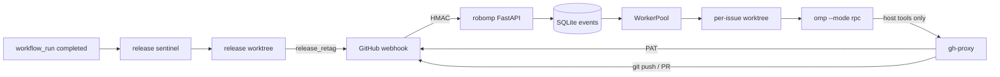

# 上游 robomp：issue → 修复 PR → 发布哨兵

> 来源：上游 `v18.16.0` 的 `python/robomp/`、`.omp/commands/`、
> `packages/coding-agent/CHANGELOG.md`（18.16.0）与 `scripts/release.ts`。
> **Zeta 已经在 v18.15.0 合并中携带 `python/robomp/`，并把命令/配置适配为
> `zetacode` / `.zeta`**；本文记录上游机制、Zeta 当前状态和仍需补齐的边界，
> 不是“从零引入”的计划。

## 一句话

robomp 是上游自托管的 GitHub 机器人：GitHub webhook 进入持久队列，每个 issue
分配独立 git worktree，子进程跑 `omp --mode rpc` 做分类、复现、修复，再通过一个
只拿 PAT 的 sidecar 写回 GitHub。它不是“第二天定时扫”，而是收到 webhook 后立即
入队；延迟只来自限流、并发和积压。

## 拓扑

- **robomp 容器**：FastAPI + SQLite 队列 + `WorkerPool`，持有 HMAC key，不持有 PAT。
- **gh-proxy 容器**：唯一持有 `GITHUB_TOKEN`，校验 HMAC 后执行 REST 与 `git push`；
  只在内部网络，另有出站到 `api.github.com`。
- **隔离**：每个 issue 一个 worktree，分支 `farm/<8hex>/<slug>`；同一 issue 的后续
  事件串行，避免并发写同一分支。release 任务按 `<repo>#release` 串行。
- **会话延续**：`omp --mode rpc` 使用持久 `session_dir`；后续评论 / PR review 用
  `--continue` 恢复同一 transcript；orchestrator 重启后从 SQLite 重新入队并继续。
- **写入面**：agent 只能用内置 `read`/`edit`/`bash`/`lsp` 和 robomp 的 `gh_*` /
  `classify_*` / `pr_review_*` host tools；不能 shell 出 `gh` 或 `git push`。

## 触发与分类

`issues.opened` / `issues.reopened` 先分类，再按 primary 分支：

| primary | 动作 |
|---|---|
| `bug` / `documentation` | 确认复现 → 最小根因修复 → 回归测试 → 开 PR |
| `question` | 一条技术回答；可选 👎 保留机制，超时自动 close |
| `enhancement` / `proposal` | 一条可行性/范围/取舍评论；**不实现**，除非维护者明确授权 |
| `invalid` / `duplicate` | 一条简短说明 / 指回原 issue |
| `wontfix` | 解释设计取舍或真正上游责任；不写代码 |

分类标签：primary 恰一个；`bug` 必有 `prio:p0..p3`；功能域
`agent|tool|tui|cli|prompting|sdk|auth|setup|ux|providers`；provider/platform
只在 issue 有明确证据时加。

`bug` 的 merit gate 很硬：必须证明是**本仓库的契约破坏**、有真实影响、不是刻意
取舍、不是 provider/运行时/依赖问题、前提为真。审计式、批量式、纯 source-reading
的“issue”不会被当成 bug。AI 生成的幻觉报告先验证前提，假前提归 `invalid`。

## bug 工作流

1. 先 `classify_issue`，再允许任何 GitHub 写操作。
2. 一条 ack 评论。
3. 在 worktree 里做最小复现，记录 `repro_record`；不能复现就
   `mark_unable_to_reproduce`，绝不猜修。
4. 找到具体代码路径，最小根因 diff，补能抓住回归的测试。
5. 跑受影响测试；提交 conventional commit，正文用真实换行，末尾 `Fixes #N`。
6. `gh_push_branch` / `gh_open_pr`：
   - 先跑 `bun run fix`，格式化 diff amend 进 HEAD；
   - 再跑 `bun check`；
   - `gh_open_pr` 还跑仓库完整 `bun run test`，红就不建 PR；
   - `skip_checks=true` 只允许“默认分支上已存在的、可复现的”失败，并在
     `## Verification` 写明。
7. PR body 固定四段：`## Repro` / `## Cause` / `## Fix` / `## Verification`，
   且必须含 `Fixes #N`。
8. 同一 issue 后续事件推同一个分支；**一个 issue 一个 PR**。

## PR review

非 bot 作者的新 PR 可触发只读 review：

- 先 `classify_pr`，给 `review:p0..p3`（P0 可立即合，P3 降级/超范围）。
- 只在 diff 上行内评论；一次 `submit_pr_review` 汇总；`event` 永远是
  `COMMENT`，不 `APPROVE`、不 `REQUEST_CHANGES`、不 merge。
- 关注 correctness、回归、安全、breaking change、测试覆盖、仓库约定；
  `bun check` / 完整测试由 PR 作者或 maintainer 负责，review bot 不代跑。

## 发布哨兵：修 CI，不决定版本

这是最容易误解的部分：

- robomp 的 `release sentinel` 默认关闭，只处理 **已经 cut 的 release**。
- 它监听 `workflow_run.completed`；只接受默认分支上、head commit subject 以
  `chore: bump version to ` 开头的运行。tag 已不再指向该 run 的 SHA 时视为 stale。
- 有 blocking conclusion（failure、timed_out 等）时，在 release worktree 里修根因，
  commit subject 必须继续带该前缀，然后 `release_retag` **原子地**推进 main 和
  已有 tag，触发下一轮 CI；最多 `ROBOMP_RELEASE_MAX_ROUNDS=5` 轮。
- 成功条件是所有 run 完成且存在非 draft GitHub Release。终态不自动发评论，
  看 dashboard / `GET /releases`。
- **它不改版本号、不改 changelog、不创建新 tag、不选 major/minor/patch。**

版本由谁选：

- `scripts/release.ts <version|major|minor|patch|canary>`；`major/minor/patch`
  只是对最新 tag 做机械 bump。
- `.omp/commands/release.md` 说得很清楚：没有给版本时，agent 看上一个 tag 之后的
  commit，自己判断 major/minor/patch；脚本不替它推断。
- 所以上游是“agent/维护者先选版本并 cut release，哨兵只负责把失败的发布 CI 修绿”，
  不是“PR 合并后按 commit 类型自动算 semver”。

## 安全边界

- GitHub PAT 只在 gh-proxy；robomp 自身环境被 scrubbed，启动时拒绝看到 PAT。
- webhook 用 HMAC-SHA256 + 时间窗 + 常数时间比较；坏签名返回 401。
- repo allowlist；`ROBOMP_MAINTAINER_LOGINS` 决定谁能让 bot 实现功能。
- `gh_push_branch` 校验分支、干净工作树、每个 commit 的作者身份；commit message
  里的字面 `\n` 会被改写为真实换行（只改 message）。
- PR 前门禁很重：格式化、`bun check`、完整 `bun run test`；这既是质量门，也是
  成本门（默认 8 并发、单任务 2400s）。
- issue 内容是**不可信输入**；agent 可能被 prompt injection 诱导。robomp 的防线是
  host tools 白名单 + worktree 隔离 + 维护者门禁，不是“模型会自觉”。

## Zeta 当前状态

- **代码已存在**：`python/robomp/` 随 v18.15.0 合并进入 Zeta；当前版本与
  `v18.16.0` 有 18 个文件的差异，主要是品牌/CLI 适配：`zetacode --mode rpc`、
  `~/.zeta/agent/models.container.yml`、`ROBOMP_OMP_COMMAND` 取值，以及
  `scripts/check-robomp-cli-contract.ts` 机器守卫。
- **离线回放已实现（REQ060）**：`triage` / `replay` / `status` 支持
  `--offline`；`triage` / `replay` 接受本地 fixture，走真实 SQLite 队列 →
  真实 git worktree → `artifacts/offline-result.json`，不启动 `zetacode`、不访问
  GitHub、不发评论/PR。宿主数据根为 `ROBOMP_DATA_DIR`，否则 Windows
  `%LOCALAPPDATA%\Zeta\robomp`、`$XDG_STATE_HOME/zeta/robomp`、`~/.zeta/robomp`。
- **工作区 XDG 已改为 `zeta`**：`$XDG_*_HOME/zeta` 是产品可识别目录；
  `.omp-xdg`/`.omp-tmp`/`.omp-session` 仍是 robomp 自用 scratch 名（改名是单独迁移）。
- **未证明已部署**：仓库里没有“生产已启用”的证据；`ROBOMP_RELEASE_SENTINEL_ENABLED`
  仍默认 `false`，release sentinel 不应被当成现状；离线回放也不启用生产 bot。
- **已知契约缺口**：`PI_ROOT`/`OMP_*` 环境变量族改名暂缓；工作区内部
  `.omp-*` scratch 目录属于 robomp 自用。启用生产 bot 前仍必须先做容器内验证，
  不能只在 Windows 上看源码。
- **因此**：当前工作不是“实现一个 bot”，而是“决定是否/何时启用已有 bot”，并把
  Zeta 的发布门禁、品牌面、权限模型接上；下面的阶段表是启用顺序，不是从零建设。

## Zeta 能复刻什么、不能直接照搬什么

### 可以学的结构

1. **事件队列 + 单 issue 串行**：比“一个 agent 同时改多个 issue”稳。
2. **worktree 隔离 + 持久 session**：后续评论能接着修，而不是重新读一遍。
3. **host tools 白名单**：模型永远不直接拿 PAT；写 GitHub 只有受审计的几个入口。
4. **PR 前门禁**：格式化、类型检查、完整测试全部绿才开 PR；不允许“先开 PR 再补”。
5. **可复现才修**：没有 repro 就只要信息，不猜。
6. **release sentinel 只修 CI**：发布决策与发布修复分离，避免 bot 自己改版本。

### 不能直接照搬

- **版本线不同**：上游 tag 是 `v18.x`，Zeta 产品线是 `1.4.x`；robomp 的
  release 前缀/版本假设要改。
- **品牌与目录**：`python/robomp` 使用 `.omp`、`omp` 命令、上游 package 名；
  作为内部开发工具可以保留兼容名，但一旦进入 Zeta 产品面必须按品牌注册表处理。
- **发布流程不同**：Zeta 的 `release-v2.ts` 要求显式版本、tag 与 dispatch；
  robomp 的 `release_retag` 不能直接套，否则会绕开现有发布门禁。
- **权限模型**：Zeta 的 GitHub 操作目前要求用户先看目标与文本；自动评论/开 PR
  是新增外部副作用，必须单独授权，不能因为“上游这么做”就默认开启。
- **成本**：完整 `bun run test` + 多轮修复的成本远高于只跑目标测试；先用小
  allowlist、低并发、按需触发，不要一上来全仓库开放。

### 建议的启用顺序（不是从零建设）

| 阶段 | 范围 | 前置 |
|---|---|---|
| 0 | 不接 webhook；用 `robomp triage` / `replay` 手动回放，验证分类与沙箱 | 容器内验证 XDG/CLI 契约 |
| 1 | 只做 issue 分类 + 评论，不写代码、不开 PR | webhook、allowlist、维护者审批 |
| 2 | `bug` → repro → 修复 PR，仍由维护者合并 | PR 门禁、bot 账号、worktree 隔离 |
| 3 | PR review bot（只 `COMMENT`，不 approve/merge） | review 规则与误报评估 |
| 4 | release sentinel，默认关闭，只修已 cut release 的 CI | 发布链稳定、tag 语义固定 |

## 相关上游入口

- `python/robomp/README.md` — 架构、部署、安全、release sentinel。
- `python/robomp/src/prompts/system_append.md` — 分类与 bug 工作流正本。
- `python/robomp/src/prompts/kickoff_issue.md` — 新 issue 启动提示。
- `python/robomp/src/prompts/kickoff_release.md` /
  `system_append_release.md` — release sentinel 的唯一职责。
- `.omp/commands/fix-issues.md` / `triage.md` / `review-prs.md` / `release.md` —
  维护者手动版流程，和 robomp 的自动版分开。
- `scripts/release.ts` — 版本 bump 与 tag 的机械实现；不做 semver 推断。
