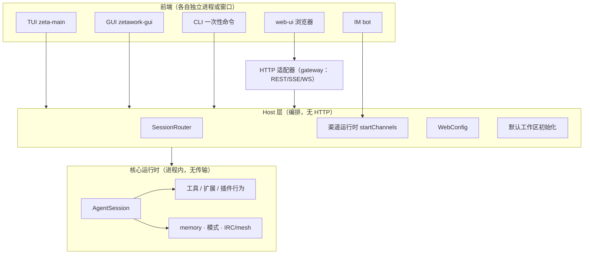

# 层级架构：谁拥有什么，谁只负责展示

本文回答三件事：现在为什么乱、目标分层是什么、**插件能不能在 Rust GUI 里原生开发**。
每一层都点名真实的文件，避免又出现"每个入口一套模型"。

## 1. 现在乱在哪（事实）

`ZetaServer`（`packages/coding-agent/src/server/zeta-server.ts:309`）一个类同时是：

| 它做的 | 证据 |
|---|---|
| HTTP 网关（REST/SSE/WS） | `#createMainServer()`（:408） |
| web-ui 静态与子进程托管 | `spawnWebUi`（:36 导入，:201 注释处的端口协商） |
| IM 渠道运行时 | `startChannels`（:28）、`#startChannelRuntime` |
| 协调者会话锚点（默认工作区） | :385 起的 `#ensureMainSession` |
| stats 子进程、桌面端点、终端 WS | 同文件各段 |

后果：所有前端（GUI、web-ui、bot）都要先有 `zeta serve` 才"完整"；GUI 少了它就没有
统计页（`main/crates/zetawork-gui/src/embed.rs` 的 `DEFAULT_STATS_URL`）、IM 回落
（`notify.rs:115` 打 `127.0.0.1:30141`）、插件页。**这是耦合，不是设计**。

web-ui 已经降级为两个职责（`web-ui/AGENTS.md` + 现状）：浏览器里的对话界面、
以及宿主 HTML 插件页（`/plugins/view/<plugin>/<page>`）。它不再承担桌面职责。

## 2. 目标分层

规则（唯一依赖方向）：

1. **Core 不依赖任何前端，也不依赖 HTTP**。
2. **Host 只编排 Core**：会话创建/路由、渠道、mesh、配置、默认工作区。
   `startChannels` 的签名已经证明这一层不需要服务器（`packages/channels/src/index.ts:133`）。
3. **HTTP 是适配器，不是中枢**：`web-gateway/*` 只做"把 Host 的能力暴露成 REST"。
4. **前端互不依赖**：GUI 不得因为缺 `zeta serve` 而少功能；web-ui 只依赖 HTTP。

## 3. 迁移顺序（每一刀都可独立验证）

1. **渠道出服务器**（进行中）：`zetacode channels` + 会话内起运行时 —— 已在
   `feat/cli-channels` 批次里。
2. **mesh 进 Core**（进行中）：`feat/agent-mesh`。
3. **Host 抽包**：把 `SessionRouter`、`WebConfig`、渠道宿主、默认工作区初始化收进
   `packages/coding-agent/src/host/`，`zeta-server.ts` 只剩：起 Host → 挂 HTTP 适配器
   → 起子进程（web-ui/stats）。
4. **GUI 不再要求 serve**：GUI 进程内起 Host；stats 用进程内采样（
   `main/crates/sysmon` 已有），只有"打开 web-ui 页面"这一件事需要 HTTP。
5. **web-ui 保持两职责**：浏览器对话 + HTML 插件宿主。

## 4. 插件层能不能在 Rust GUI 里原生开发（回答）

要分三类，混在一起谈就会得出"要么全 3D 原生重写、要么永远 iframe"的错误结论：

| 插件产物 | 归宿 | 理由 |
|---|---|---|
| **行为**（工具/命令/钩子/消息） | 进程内 TS，与前端无关 | 已在做（`ctx.agents`/`ctx.messaging`/工具注册），GUI 通过 Host 直接消费 |
| **声明式面板** | **Rust GUI 原生渲染（推荐新增）** | 面板只是"列表/表单/图/状态"，声明成 schema 就能原生画：原生主题、无 webview、无第二个 HTTP 服务、启动即用 |
| **任意 HTML 页** | 只能 webview（`/plugins/view/…`） | 第三方页面无法原生化；这是 OMP 生态兼容面，保留但**不是默认** |

具体做法：给插件清单加 `ui.panels[]`（`kind: "list" | "form" | "chart" | "html"`，
前三种带 `source` 指向数据端点/工具调用，最后一种带 `entry` 指向 HTML）。Rust GUI 原生
渲染前三类；只有 `kind: "html"` 才落到 webview。第一方面板（Board、任务、资源）一律走
声明式，Rust 侧因此是"一等公民"而不是补丁。

判据：**能不能原生，取决于面板是不是声明式，而不是取决于插件用什么语言写的。**

## 5. 明确不做

- 不把 web-ui 拆成第二个产品；它降级的定位就此固定。
- 不要求第三方插件写 Rust；Rust 只是宿主。
- 不在本期做跨机 mesh、插件市场。
