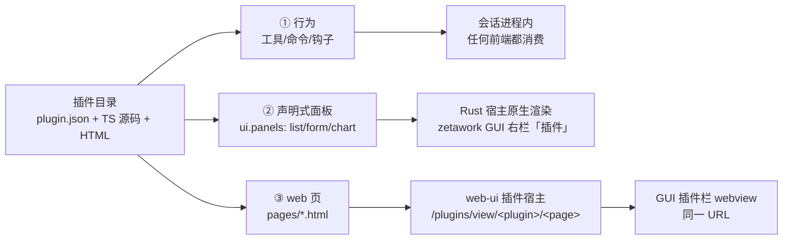

# Zeta 插件系统设计（草案）

> 内部设计文档，未打包。目标：为 Zeta 官方/社区插件、插件商店、以及
> pi-messenger 这类用户可选插件的安装/发布/依赖关系提供统一方案。
> 状态：草案，2026-08-26 评审通过关键决议，进入多版本准备。

## 背景

- `@linxiraos/pi-messenger` 是第一个用户可选插件：不随主包打包，用户按需安装。
- 教训：1.1.0/1.1.1 发布时只改了 `name`/`version`，`peerDependencies` 和源码
  import 仍指向上游 `@earendil-works/*`，导致 Zeta 用户安装时把整套上游运行时
  当 peer 拉进来，扩展加载到的是上游运行时而不是 Zeta 运行时（"依赖关系没弄对"）。
- 上游（OMP/pi 生态）插件数量会增长，每次都往上游拉/手动改会越来越混乱，需要
  Zeta 自己的插件清单与查询体系。

## 目标

1. 用户可选的插件安装，分两种路径：
   - **web/CLI**：npm 装包，直接装进 CLI 的扩展系统。
   - **桌面应用**：从 GitHub 源码拉取，或从 release 拉插件压缩包，解压后自动
     安装到桌面二进制对应的插件安装路径。
2. 插件商店：在 web UI / 桌面应用中显示，支持离线展示与在线更新。
3. 插件分两套（定义更严谨）：
   - **官方（official）**：Zeta 第一方移植/维护。由我们亲自把其他开源仓库（
     MIT、Apache-2.0 等）的插件 fork/移植过来，或 Zeta 自研插件。来源与
     依赖改写都由我们负责，保证正确。
   - **社区（community）**：外部第三方提交、或收录自 pi/omp 上游、经我们
     验证可用的插件。
4. 上游插件集成时必须改写依赖/源码 import（`@earendil-works/*` → `@linxiraos/*`），
   确保扩展 peer 到 Zeta 运行时。
5. Zeta 自己的插件查询/清单体系：一次集成、收录进我们的清单，用户/桌面/网页
   都查我们的清单，不每次往上游拉。

## 仓库布局

```
plugins/
├── official/                     # Zeta 官方插件（源码在仓内开发）
│   ├── <plugin-id>/
│   │   ├── plugin.json / plugin.toml  # 清单（随打包一起分发）
│   │   ├── package.json          # @linxiraos/*，peer 全部指向 @linxiraos/*
│   │   ├── src/                  # 扩展工厂源码（registerTool / registerCommand）
│   │   ├── crew/ skills/ README.md CHANGELOG.md tests/
│   │   ├── locales/              # 插件 i18n 字符串表（locales/{zh,en}.json，见下文）
│   └── INDEX.md                  # 官方插件追踪文档（类别、来源、兼容性）
└── community/                    # 社区：只有元数据指针文件，不放代码
    ├── <plugin-id>.json|.toml    # 上游仓库地址 + 依赖处理说明 + 准入 CI 证明
    └── INDEX.md                  # 来源、拉取方式、兼容性记录
```

- 每个集合根目录的清单/菜单可直接打包进桌面或 web，支持离线显示或在线更新。
- 社区集合的 `INDEX.md`：写明每个插件从哪里获得、怎么拉取、是否兼容过、
  兼容性描述。官方集合同样有一份小文档 + 关键字段。

## 清单字段（草案，plugin.json / plugin.toml）

```jsonc
{
  "id": "pi-messenger",
  "name": "Messenger",
  "description": "Inter-agent messaging and file reservation",
  "source": "https://github.com/nicobailon/pi-messenger",
  "publish": "@linxiraos/pi-messenger",   // npm 包名（若走 npm）
  "install": "npm",                        // npm | github | release-zip
  "compat": { "zeta": "^1.1.0" },
  "unuse": false,                          // true = 暂不启用（不展示/不安装）
  "category": "community"                  // official | community
}
```

- 机器可读清单字段以 JSON 为主；TOML 用于偏配置/人设类条目（persona、agent
  定义），两者等价、可互转，解析器二选一。
- 官方/社区集合的菜单与追踪文档用 markdown（人类可读、可叙述兼容性）。

## 插件宿主 i18n（已实现）

插件把用户可见字符串放进 JSON 字符串表，由宿主注入 `t()` 读取。实现位于
`packages/coding-agent/src/extensibility/plugins/locales.ts`（loader）与
`extensibility/extensions/runner.ts`（按扩展注入 `ctx.t()`）。

```json
// package.json
{
  "name": "@linxiraos/example-plugin",
  "version": "1.0.0",
  "zeta": {
    "version": "1.0.0",
    "extensions": ["./index.ts"],
    "locales": { "zh": "locales/zh.json", "en": "locales/en.json" }
  }
}
```

```json
// locales/zh.json —— 必须是平坦的 Record<string, string>
{ "greeting": "你好" }
```

- 清单字段：`locales?: { zh?: string; en?: string }`，值为相对插件根的路径。
  loader 解析时校验：非字符串路径、空路径、未知语言标签都会产出明确错误
  （例如 `` `locales.zh` must be a string path to a JSON catalogue, got number ``），
  该声明按无效处理。未声明 `locales` 时回落到约定的
  `locales/{zh,en}.json`；声明了某语言则覆盖该语言的约定路径。
- 加载：每个插件只读一次并按插件根缓存（随插件发现缓存一起失效）。缺失文件
  静默回落；清单声明了但读不到、JSON 损坏、根不是对象、值非字符串时记 warning
  并跳过该语言的表——插件本身照常加载。
- 注入：`ctx.t(key, fallback?)` 出现在该插件扩展的 event handler、tool
  `execute`、command、shortcut 上下文里，绑定的是**该扩展所属插件**的字符串表，
  不会把别的插件的文案泄漏进来。非插件来源的扩展（`settings.extensions`、
  `-e`、inline factory）没有字符串表。
- 查找顺序：当前宿主语言 → `en` → 调用方 `fallback` → `key`。语言每次调用实时
  读取，`/language` 切换立即生效，不重载插件、不重读 JSON。
- 未携带 `locales/` 的插件行为不变：`ctx.t("k", "text")` 返回 `"text"`，
  `ctx.t("k")` 返回 `"k"`。

## 三层模型（2026-10-20）

插件产物固定为三层。混为一谈会得出"要么全原生重写、要么永远 iframe"的错误结论；
分层的判据是**插件产物是哪一类**，不是插件用什么语言写的。



| 层 | 产物 | 执行/渲染方 | 依赖 | 例子 |
|---|---|---|---|---|
| ① 行为 | 工具、命令、钩子、消息 | 会话进程内的 TS 扩展；GUI/TUI/CLI 都通过 Host 消费 | 无前端依赖 | `example_panel_data`、`/example-panel` |
| ② 声明式面板 | `plugin.json` 的 `ui.panels`（`list`/`form`/`chart`） | 有原生渲染器的宿主（`main/crates/zetawork-gui/src/plugin_panels.rs`） | 不需要 `zetacode serve`、不需要 webview | 任务表、设置表单、状态柱状图 |
| ③ web 页 | 插件包内任意 `.html` | web-ui 插件宿主（`web-ui/lib/plugin-pages.ts` + `/api/plugin-assets`），GUI 的插件栏用 webview 打开同一 URL | 需要 web-ui（由 `zetacode serve` 起） | `pages/index.html` |

### 选层决策表

| 你要做的事 | 选哪层 | 依据 |
|---|---|---|
| 模型/用户要触发的**动作**（读写文件、调 API、编排代理） | ① 行为（工具或命令） | 这是插件唯一能改变状态的地方；前端只消费 |
| 想在自己的**窗口里看到结构化数据**（表格/键值/图表） | ② 声明式面板 | 声明即可原生绘制：原生主题、无 webview、无第二个 HTTP 服务、启动即用 |
| 需要**任意 HTML/JS/CSS**、第三方图形库、或已有网页 | ③ web 页 | 任意页面无法原生化；这是 OMP 生态兼容面 |
| 想同时要原生面板和网页 | ①+②+③ 同时声明 | 同一个插件可以三层齐全（`example-panel` 就是） |
| 目标前端是 TUI（`zeta-main`）或 IDE（`termide`/`zetaide`） | 都不选 | 这两个前端**没有**插件层（见下），插件不为它们加钩子 |

**判据**：能不能原生，取决于**面板是不是声明式**，而不是取决于插件用什么语言写的。
第三方插件不写 Rust；Rust 只是宿主。

### ② 的清单契约

```jsonc
// plugin.json
{
  "ui": {
    "panels": [
      { "id": "tasks", "title": "Tasks", "kind": "list",
        "source": { "tool": "example_panel_data", "args": { "panel": "tasks" } },
        "columns": ["id", "title", "owner", "state"] },
      { "id": "settings", "title": "Settings", "kind": "form",
        "source": { "tool": "example_panel_data", "args": { "panel": "settings" } } },
      { "id": "throughput", "title": "Tasks by state", "kind": "chart",
        "source": { "tool": "example_panel_data", "args": { "panel": "throughput" } } },
      { "id": "guide", "title": "Guide", "kind": "html", "entry": "pages/index.html" }
    ]
  }
}
```

- `kind`：`list` | `form` | `chart` | `html`，别的值一律拒绝。
- 前三种**必须**有 `source: { tool, args? }`：一次**工具调用**，不是 HTTP 路由。
  两个理由：(a) 生产数据的那段代码本来就以工具形式注册，不需要第二个发布面；
  (b) 面板必须在 `zetacode serve` 没起来时也能画 —— 前端不依赖 HTTP 适配器是
  本仓的分层规矩（`document/architecture-layers.md` §2.4）。网关仍然是浏览器
  访问同一插件的路径，它不是桌面面板的前置条件。
- `html` **必须**有 `entry`（插件包内相对路径、`.html`），且**不得**声明
  `source`；`entry` 就是 web-ui 已经寻址的 `<page>`，所以 html 面板复用
  `/plugins/view/<plugin>/<entry>`，不另造 URL 方案。
- `columns` 只对 `list` 有意义；`id` 必须匹配 `[a-z0-9][a-z0-9-]*` 且插件内唯一。
- 校验有两处，都必须拒绝同一批形状并点名出错条目（如
  `` `ui.panels[2].kind` must be one of: list, form, chart, html — got "table" ``）：
  TS 侧 `parsePluginUi`（`packages/coding-agent/src/extensibility/plugins/parser.ts`），
  Rust 侧 `plugin_panels::parse_manifest`。清单在包 `package.json` 的 `zeta` 块里声明
  `ui` 也合法（`PluginManifest.ui`），loader 校验失败时记 warning 并丢弃该块，插件
  照常加载 —— 与 `locales` 的处置一致。
- 兼容性：未声明 `ui` 的插件行为与今天完全一致（无面板、无渲染路径）。

### ② 的数据契约（工具返回的 `details`）

| `kind` | `details` 形状 | 渲染 |
|---|---|---|
| `list` | `{ "rows": [{ "<column>": 标量 }] }` | 每行一个对象，按 `columns` 取格子；缺列显示 `—` |
| `form` | `{ "fields": [{ "key", "label", "value" }] }` | 只读键值行；`label` 由插件用 `ctx.t()` 本地化 |
| `chart` | `{ "points": [{ "label", "value": number }] }` | 水平柱状图，按声明顺序 |

### 宿主行为（zetawork GUI）

- 右栏新增「插件」页（`state::RightTab::Plugin`）：一行插件选择条 + 一行面板
  选择条，选中即渲染。面板从两个真实安装根发现：`~/.zeta/agent/plugins/<plugin>/`
  （直接投放）与 `~/.zeta/plugins/node_modules[/@scope]/<plugin>/`（npm 安装），
  读 `plugin.json`，没有 `ui` 时回落到 `package.json` 的 `zeta.ui`。
- 声明式面板：宿主调 `zetacode plugins panel <plugin> <panel> --json`（同一工具
  注册面），把返回的 `details` 画成原生控件；数据在 `probe` 为真时才去取，
  取不到就显示原因，不编造行。
- `html` 面板：宿主把右栏 body 的矩形交给已有的 WebView2 子窗口
  （`main/crates/zetawork-gui/src/embed.rs`），地址是
  `<webUrl>/plugins/view/<plugin>/<entry>`；`webUrl` 来自 `~/.zeta/serve.json`，
  没有就明说 web-ui 未启动 —— 与「用量」容器的回落一致。

### 明确不做

- `zetacode`/`zetaide`（termide）**没有**插件层：不加插件钩子、不发现插件面板。
  `main/crates/zeta-main/tests/no_plugin_layer.rs` 与
  `termide/` 的源码扫描把这个约束钉成测试，防止静默回归。
- `zetawork` TUI 同样**没有**插件层（本期不做）：
  `main/crates/zeta-main/tests/no_plugin_layer.rs` 一并断言。
- 插件不写 Rust；不在本期做插件市场/跨机 mesh。

## 依赖关系规则

- 任何上游插件集成进 Zeta 前，必须把 `@earendil-works/*`（以及任何上游运行时
  引用）改写成 `@linxiraos/*`：
  - `package.json` 的 `dependencies`/`optionalDependencies`/`peerDependencies`。
  - 源码 import（`*.ts`/`*.mjs`/`*.js` 等）。
- 工具化：`scripts/publish-missing-packages.ts` 的 `rewriteEarendilDeps` 在发布
  pi-messenger 前自动改写、发布后恢复。自 `plugins/official/` 标准路径生效起，
  该改写成为官方插件的**常驻构建步骤**（源码内直接持 `@linxiraos/*` 引用），
  不再依赖发布时临时改写。
- 版本线：用户可选插件（如 pi-messenger）不强制进主构建，但版本号跟随 Zeta
  发布版本，避免与其他 `@linxiraos/*` 包版本线撕裂。

## 发布与查询

- 查询系统（待设计）：Zeta 自己的插件清单端点/目录，web 与桌面都从它查询，
  支持离线缓存与在线更新；不直接依赖上游仓库的实时状态。
- 发布路径：
  - web/CLI：`@linxiraos/*` npm 包（trusted publishing）。
  - 桌面：GitHub release 插件压缩包，或仓库内 vendored 源码打包。
- pi-messenger 当前：已迁移至 `plugins/official/pi-messenger/`（随 Zeta 发布线
  版本化），`temp/` 参考克隆已清理。
- 插件相关支持包：除 pi-messenger 外，后续大概率还会有更多插件依赖的
  支持包，统一走同一套发布/依赖规则。

## 贡献指南与社区准入

- 根 `README.md` 提供第三方插件贡献指南：
  - 如何把仓库配置正确并正常 npm 发包（trusted publishing / OIDC）。
  - 即使不走 npm 发包，若 fork 了别人 pi/OMP 的插件，也要在插件清单里
    写明针对我们 `@linxiraos/*` 的依赖改写关系。
- `docs/`（随产品打包的运行时文档树）对包依赖关系做描述，便于贡献者核对。
- 社区插件准入流程：
  1. 外部贡献者提交 PR（携带插件清单 + 依赖改写说明）。
  2. 我们为其提供/要求一套插件 CI 与 test，专门校验依赖是否改写正确
     （`@earendil-works/*` → `@linxiraos/*`、peer 解析、加载冒烟）。
  3. 该 CI 通过后，评审通过，才把插件描述加入 `plugins/community/` 索引。
- 官方插件定义更严格：仅指我们第一方移植/维护的开源插件（MIT、Apache-2.0
  等）或 Zeta 自研插件；来源与依赖改写都由我们负责。

## 2026-08-26 设计决议（评审通过，进入多版本准备）

### 官方插件三件套与依赖顺序

```
P0 agent-team（无 UI）—— 基座，前置中的前置
   ├── 场景一：多代理任务编排（crew: plan → work → review）
   └── 场景二：个人助理 / 多 AI 人设群聊（多个配置的 AI 各自带人设自主对话）
        ↑ 依赖                ↑ 依赖
     P1 桌宠助手（带 UI）   P2 科学插件（带 UI）
```

- P0 是「前置的前置」：P1（系统级桌宠助手，Linux 首发）与 P2（科学插件）都依赖它。
- 场景二（个人助理群聊）是 agent-team 的第二个形态：配置多个 AI、各自带人设，
  自主聊天，Neuro-sama 类娱乐向联动；它是 P1 桌宠「有性格」的底层能力。
- 三个插件目标在同一体系内一次性打通：同一份 manifest v2、同一套动态插入机制。

### 仓库内标准路径（取代 `temp/pi-messenger`）

- 问题（当时的事实，2026-08-26 迁移决定）：pi-messenger 源码现位于
  `temp/pi-messenger`（gitignored，等同未版本化），
  打包路径与逻辑都不对。
- 决定：官方插件统一收进 `plugins/official/<plugin-id>/`，成为仓库内受管子仓库。
- `plugins/official/pi-messenger/` 标准模板：

  ```
  plugins/official/pi-messenger/
  ├── plugin.json / plugin.toml    # 清单（id/name/source/publish/install/compat/category）
  ├── package.json                 # @linxiraos/pi-messenger，peer 全部指向 @linxiraos/*
  ├── src/ 或入口 index.ts         # 扩展工厂：registerTool / registerCommand
  ├── crew/agents/*.md             # 团队代理定义
  ├── skills/                      # 自带 skills
  ├── locales/                     # 插件 i18n 字符串表（locales/{zh,en}.json，见下文）
  ├── README.md / CHANGELOG.md
  └── tests/
  ```

- 打包/发布：从 `plugins/official/<id>/` **原样打包**并 trusted-publish（`ci.yml`
  的 `release_plugin_packages` → `ci-release-publish.ts --plugin plugins/official/<id>`：
  插件发的是宿主加载器要 transpile 的 TS 源码，不走 workspace `packages` 表的
  declaration emit 路径）；版本线与 Zeta 发布版本对齐；`@earendil-works/*` →
  `@linxiraos/*` 的 peer/源码改写是该插件**常驻构建步骤**，不再依赖发布时临时改写。

### 清单格式：JSON + TOML 双格式

- 机器可读清单 JSON 为主；TOML 用于偏配置/人设类条目（persona、agent 定义），
  两者等价、可互转，解析器二选一。
- `community/` 目录 = 纯指针文件（JSON 或 TOML）：上游仓库地址 + 依赖处理说明
  （如何映射到 `@linxiraos/*`）+ 准入 CI 证明文档；不放代码。

### 分发与查询（A + B 双轨）

- A 构建期打包：发布时把 `plugins/` 目录快照打包进产物（离线可用、版本锁定），
  方式同 `PI_DOCS_EMBED`。
- B 运行时刷新：手动「刷新目录」从 GitHub raw 拉最新 `plugins/community/`
  （带缓存）。
- 桌面与 web 共用同一份商城页（web-ui 内置「插件」页）；桌面壳只加两处小活：
  托盘菜单列出已启用并声明 windows 的插件（如 P1 悬浮窗开关）、安装影响原生
  窗口时提示重启 shell。

### 平台与模式决议

- P1 桌宠：**Linux 首发**。
- science/research：**新增 Zeta 模式，由插件安装后注册**。前置小重构：把
  `ModeId = "plan" | "goal" | "vibe"` 硬编码 union + enterMode/exitMode 的 switch
  抽为 `ModeRegistry`——内置三模式平移为默认注册项（行为零变化），插件贡献
  `{ id, promptPack, toolWhitelist, enter, exit }`。
- 调度器：做进 **`zeta serve` 进程内的插件调度模块**（P2 定时文献扫描/pipeline 与
  P1 定时主动行为共用）；pulse-daemon 保持地基定位，仅接收调度事件上报。

### pi-messenger 激活链路（试点）

- CLI：`zeta plugins install @linxiraos/pi-messenger` → 装进 `~/.zeta/plugins/`
  （`installPlugin()` 现有实现）登记 lock 文件；或 settings `extensions` 路径
  走 `discoverExtensionPaths()`。激活后：`pi_messenger` 工具（join/send/reserve/
  release/plan/work/review）+ `/messenger` 指令 + crew agents 自动发现 + skills 加载。
- 桌面：spawn `zeta serve`（`ZETA_DESKTOP=1`）服务端加载同一插件，工具经网关
  自动可用；但 `/messenger` 的 TUI overlay 在 `!ctx.hasUI` 分支直接返回——web
  需要独立显示面，不能复用 TUI overlay。
- web 显示面（team agent 特有）：成员名册、消息流、文件预留、任务看板、
  messenger 设置——全部走 manifest v2 `pages` + gateway `/api/plugin-assets` iframe
  动态插入。
- i18n（**机制已落地，文案抽取仍暂缓**）：插件在 `package.json` 的
  `zeta`/`omp`/`pi` 清单里声明 `locales: { zh, en }`（相对插件根的 JSON 路径；
  未声明时回落到 `locales/{zh,en}.json`），宿主把 `ctx.t(key, fallback?)` 注入给
  该插件扩展的 handler / tool / command / shortcut，按「当前语言 → en →
  fallback → key」查找，语言实时读取、`/language` 切换无需重载插件。细节见
  [「插件宿主 i18n」](#插件宿主-i18n已实现)。
  messenger 现有英文硬编码文案（overlay / 命令 / 工具描述 / handler 文案）的抽出 +
  zh 条目仍然暂缓（抽取前先确定"用户可见 UI 文案"与"模型可见提示词"的边界）。

## 未决问题（2026-08-26 更新）

- 插件商店 UI 交互细节（已定共用 web-ui 商城页，交互未细）。
- 桌面插件签名/校验（防篡改）。
- P0 场景二（人设群聊）的编排规则与交互形态（Neuro 系玩法细化）。
- `ModeRegistry` 重构的兼容面验证（内置三模式行为必须零变化，含回归测试）。
- 社区插件准入 CI 的具体形态（依赖改写校验 + 加载冒烟）。

agent-team 完整开发规格（编排器 / `team_*` 工具 / 人设群聊 / Web pages）→ [agent-team-plugin.md](./agent-team-plugin.md)。
