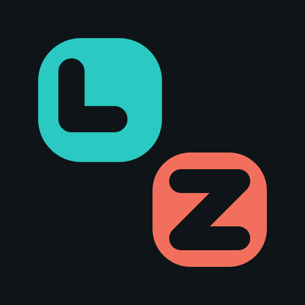

<p align="center">
  
</p>

<p align="center">
  <a href="https://github.com/Linxira-OS/linxira-zeta/releases"></a>
  
  
  
  <a href="https://github.com/Linxira-OS/linxira-zeta/actions"></a>
</p>

[English](../README.md) · **简体中文**

Zeta 是一套 agent 工作区套件：**Z Work Studio**（由 CLI `zetacode serve` 托管的
浏览器工作台），加上编码 Agent（`zetacode`）、终端 IDE（`zetaide`）以及两者共用
的编辑器载荷。它是 **Agent 开发环境（ADE）**，不是“IDE 加聊天框”：会话是工作
单元，每个面板都是 agent 可以使用的工作面。Linux 是主力平台；支持 Windows x64；
不构建 macOS。不存在 Rust 桌面 UI：桌面版承载的是同一个浏览器工作台。

Zeta 是 [OMP](https://github.com/Linxira-OS/linxira-zeta) 的下游分支，采用 MIT 许可。
集成的运行时源码为 OMP **v18.22.0**。Z Work Studio 是
[OMP Studio](https://github.com/the-snowpear/omp-studio) 的受维护分支，其
**v0.2.1** 源码谱系已集成，完整验收与 CI 仍待完成。`zetaide` vendored 了
[TermIDE](https://github.com/termide/termide) **0.49.0**。上游版权声明与许可
文本保留在 [`LICENSE`](../LICENSE) 与 [`NOTICE`](../NOTICE)；逐树的改动记录在
[`THIRD-PARTY-NOTICES.txt`](../THIRD-PARTY-NOTICES.txt)。

## 快速开始

安装 CLI 并在浏览器里打开工作台（需要 Node 18+ 或 Bun）：

```sh
npm i -g @linxiraos/zeta      # 或：bun add -g @linxiraos/zeta
zetacode serve                # 在 loopback 上提供 Z Work Studio
```

Z Work Studio 随该包装在 `dist/web-app`；自定义构建可用 `ZETA_WEB_APP_DIR`
覆盖渲染器。`zetacode serve` 是受支持的入口。终端 IDE 单独安装：

```sh
npm i -g @linxiraos/ide       # zetaide — 终端 IDE
```

编辑器是工作台里的面板，不是独立工具：`@linxiraos/editor` 是预留包名，其载荷
当前不发布。

桌面版打包同一个运行时，并启动随包的 `zetacode serve`。浏览器版把服务 URL 交给
默认浏览器；Electron 版在窗口里加载同一个服务器。两者都复用独立 serve 现有的
HTTP 认证，目标机器无需 Bun 或 Node。不存在 Rust 桌面 UI。见
[`docs/desktop-app.md`](../docs/desktop-app.md)。

从源码检出运行：

```sh
bun install
bun run build:native
bun run dev
```

## 套件

| 命令       | 包                 | 是什么                                             |
| ---------- | ------------------ | -------------------------------------------------- |
| `zetacode` | `@linxiraos/zeta`  | 编码 Agent CLI；`zetacode serve` 打开 Z Work Studio |
| `zetaide`  | `@linxiraos/ide`   | 终端 IDE（TermIDE，vendored Rust）                  |

每条命令都能独立启动，各有自己的 `--help`。Z Work Studio 就是工作台：
`zetacode serve` 提供的页面与 CLI 共用运行时、宿主契约（`/api/v1/*`）和设置，
编码/编辑交给 `zetacode` 与 `zetaide`，不另做一套。`zetawork` / `zeta` 两个 bin
仍在暂停的 `@linxiraos/main` 包里；名字保留给 main/super-agent 面，没有 Rust GUI
随它出货。

## 覆盖率

覆盖率是被测量和评审的，不由阈值强制。基线（2026-11-03）、已加载文件注意事项
与逐包指标见[仓库与开发](development.zh-CN.md#覆盖率)；维护者策略见
[`.github/MAINTAINERS.md`](../.github/MAINTAINERS.md)。

## 文档

- [产品与平台](product.zh-CN.md) —— 套件、Z Work Studio 及其桌面版、编码 Agent、
  ADE 模型、能力与平台支持。
- [仓库与开发](development.zh-CN.md) —— 分层、仓库地图、文档树、构建/测试命令与
  覆盖率策略。
- [维护与归属](ownership.zh-CN.md) —— 维护角色、问题路由、上游政策、逐组件谱系、
  商业面与许可。
- [`docs/`](../docs/) —— **随产品打包的运行时文档**，通过 `zeta://docs` 提供，
  面向用户、运维和扩展作者。
- [`document/`](../document/) —— **内部工程文档**，永不打包：架构、ADR、路线图、
  同步台账与发布流程。

## 贡献与安全

贡献规则、PR 要求与 AI 辅助贡献政策见
[`CONTRIBUTING.md`](../CONTRIBUTING.md)（[简体中文](../CONTRIBUTING.zh-CN.md)）。
漏洞请通过 [`.github/SECURITY.md`](../.github/SECURITY.md)
（[简体中文](../.github/SECURITY.zh-CN.md)）描述的私有 advisory 报告，绝不使用
公开 issue 或 pull request。advisory 表单：
<https://github.com/Linxira-OS/linxira-zeta/security/advisories/new>。

## 基础上游（致谢）

三个项目使 Zeta 成为可能，感谢它们的作者与贡献者。

| 项目 | 集成来源 | Zeta 取自它的部分 |
| --- | --- | --- |
| [OMP](https://github.com/Linxira-OS/linxira-zeta)（zeta），MIT | `v18.22.0` | 运行时树：agent、工具、TUI、模型 catalog、wire 协议 |
| [OMP Studio](https://github.com/the-snowpear/omp-studio)，MIT | `v0.2.1` 源码谱系（验收与 CI 待完成） | Web UI：renderer、client 及其 host 契约 |
| [TermIDE](https://github.com/termide/termide)，MIT | `0.49.0` | `zetaide` 与内置编辑器面板 |

更多上游塑造了更早的工作并仍在致谢之列：
[Pi](https://github.com/earendil-works/pi) / [Pi Web](https://github.com/agegr/pi-web)
作为语义移植来源，[OMP Web](https://github.com/17380936778/omp-web) 作为冻结的
`web-ui/` 快照来源。逐树改动账目与完整 fork 声明见
[`THIRD-PARTY-NOTICES.txt`](../THIRD-PARTY-NOTICES.txt)。

## 许可证

Zeta 按路径承载两种许可：

- `main/` —— 暂停的 Rust 工作台 —— 为 **AGPL-3.0-only**
  （[全文](../main/LICENSE)）。
- `main/` 之外的全部路径为 **MIT**，包括 `packages/`、`crates/`、`sdk/`、
  `web-app/`、`desktop/`、`docs/`、`document/`、`scripts/` 与 `rep-docs/`。
  `termide/` 与 `editor/` —— vendored TermIDE —— 为 **MIT**
  （[全文](../termide/LICENSE)）。

根目录 [`LICENSE`](../LICENSE) 说明分层，并复述管辖 `main/` 之外全部代码的 MIT
文本。派生与 vendored 项目保持各自许可，列在
[`THIRD-PARTY-NOTICES.txt`](../THIRD-PARTY-NOTICES.txt)。Zeta 的版权行只标注
Zeta 的修改与新增；上游部分仍以上游版权声明与许可文本为准。许可文本不作翻译。

[English](../README.md) · **简体中文**
