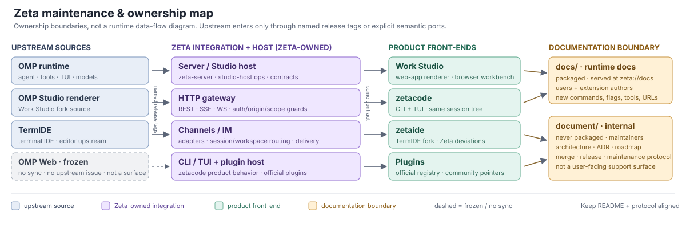

# Ownership and attribution

**English** · [简体中文](ownership.zh-CN.md)

Zeta is a downstream distribution with a deliberate boundary: upstream defects
follow the upstream release process, while Zeta's product behavior, integration,
and usage differences are ours. The authoritative internal protocol — issue
routing, surface ownership, module map, and security channel — is
[`document/maintenance-ownership.md`](../document/maintenance-ownership.md).
Release-tag baselines are recorded in
[`document/upstream-baselines.md`](../document/upstream-baselines.md).

## Maintenance and ownership

| Surface | Upstream | Maintained by |
| --- | --- | --- |
| `zetacode` runtime, CLI, TUI | [OMP](https://github.com/can1357/oh-my-pi), only through named official release tags | **Zeta core maintainers** for Zeta deltas; upstream for a clean upstream defect |
| Z Work Studio (`web-app/`), server/Studio host, `/api/v1/*` and Web Gateway | OMP Studio renderer fork; host, contracts, gateway, and fork integration are Zeta-owned | **Zeta server maintainers** |
| IM (`packages/channels/`, `packages/coding-agent/src/channels/`) | Zeta-originated channel runtime | **Zeta IM maintainers** |
| `zetaide` and the editor payload (`termide/`, `editor/`) | [TermIDE](https://github.com/termide/termide), vendored fork | **Zeta IDE maintainers** for fork deviations and branding |
| `desktop/` — the Electron and browser desktop editions | Zeta-originated desktop packaging and shell | **Zeta core maintainers** |
| `android/`, `main/` | Zeta-originated; paused or experimental lines | **Zeta core maintainers**; no new product work while paused |
| `plugins/`, `docs/`, `document/`, `rep-docs/` | Zeta registry and documentation surfaces | **Zeta core maintainers** |
| `web-ui/` | Frozen OMP Web snapshot | No Zeta owner, no sync, not a product surface |

## Where to report

Route a problem by where it reproduces, not by which file happens to be nearest.

1. **Upstream defect** that reproduces without the Zeta overlay → the upstream
   project's issue tracker: OMP for the runtime, TUI, tools, and models; OMP
   Studio for a renderer/host-contract defect with a clean upstream
   reproduction; TermIDE for terminal, editor, LSP, and DAP. Zeta consumes a
   fix only through the next **named official release tag**; never merge
   upstream `main` or a branch, and never cherry-pick a partial diff. The
   integrated runtime source is OMP `v18.22.0`. Z Work Studio's OMP Studio
   `v0.2.1` source ancestry is integrated, with full acceptance and CI still
   pending; later tags are not integrated until a named release sync lands.
2. **Zeta feature, usage difference, or integration** → this repository's
   issue tracker, with the owning role above. Upstream should not be asked to
   own our product behavior or usage differences.
3. **Security vulnerability** → the private advisory in
   [`.github/SECURITY.md`](../.github/SECURITY.md), never a public issue or
   pull request. IM and server findings are private-first.

`zetaide` and coding-agent additions made because of Zeta usage differences are
maintained by Zeta, not upstream.

## Upstream policy

Zeta follows OMP and OMP Studio only through complete, official release tags.
Each release is merged as real Git history on a temporary integration branch,
then receives any required Zeta package, brand, Bun, CI, and product
adaptations in separate commits. The exact source tag, SHA, conflict decisions,
and checks are recorded in
[`document/upstream-sync.md`](../document/upstream-sync.md).

Pi is a semantic feature source, not a raw merge source
([Pi](https://github.com/earendil-works/pi)). [Pi Web](https://github.com/agegr/pi-web)
is credited as a semantic source for web features;
[OMP Web](https://github.com/17380936778/omp-web) is a frozen snapshot. See
[`AGENTS.md`](../AGENTS.md) for the repository rules.

## Component lineage

| Component | Origin |
| --- | --- |
| `web-app/` (Z Work Studio renderer) | Zeta-maintained fork of OMP Studio (MIT); `v0.2.1` source ancestry integrated |
| `main/` (Rust workbench, paused; `@linxiraos/main`, bins `zetawork`/`zeta`) | Zeta-originated; AGPL-3.0-only |
| `packages/coding-agent/` (CLI, `zetacode`) | OMP runtime tree, release-tag merges |
| `packages/ai`, `agent`, `catalog`, `tui`, `natives`, `utils`, `stats` | OMP runtime tree |
| `termide/` (TermIDE, `@linxiraos/ide`, binary `zetaide`) | [termide/termide](https://github.com/termide/termide), vendored fork (maintained here), `0.49.0` |
| `web-ui/` | **Abandoned** third-party OMP Web snapshot (`17380936778/omp-web`); not built |
| `desktop/` | Zeta-originated desktop packaging and shell (Electron and browser editions) |
| `packages/coding-agent/src/channels/` (WeChat/Feishu/Telegram bridge) | Zeta-originated |
| `packages/coding-agent/src/server/` (web-gateway, `zetacode serve`) | Zeta-originated |

## Differences from upstream

Attribution only means something if the boundary is explicit: upstream notices
cover upstream code, and Zeta's copyright covers what Zeta changed or added on
top. Per product surface:

### `zetacode` — coding agent and runtime (from OMP)

- **Upstream**: [OMP](https://github.com/can1357/oh-my-pi), merged whole at
  official release tags. The integrated source is `v18.22.0`
  (`3e8cff3b7ce19a805c11a26a6dd1703066435851`): `packages/*`, `crates/*`,
  `sdk/*`, `python/*`, and the TUI.
- **Zeta changes**: product identity (`.zeta`, `zetacode`, `zeta://`,
  `@linxiraos/*`, `zeta-cli-*` assets, frozen splash art); internal `__zeta*`
  markers; user-visible configuration uses Zeta names, and retired upstream
  configuration aliases and status directories are not loaded; foreign
  project-config sources gated behind explicit consent; tool exposure tiers;
  telemetry hard-off; Zeta service ports.
- **Zeta features on top of the runtime** (each documented in `docs/`):
  `zetacode serve` and the Web Gateway REST surface backing Z Work Studio
  ([serve](../docs/zeta-serve-web.md), [gateway API](../docs/web-ui/api.md));
  ultra plan mode ([plan approval](../docs/plan-approval.md)); cross-session
  project tracking ([tracking](../docs/zeta-tracking.md)); the channel runtime
  ([channels](../docs/channels.md)); agent hub and mesh
  ([hub](../docs/agent-hub.md), [mesh](../docs/agent-mesh.md)); the plugin
  registry ([plugins](../docs/plugins.md)); usage/statistics dashboards;
  windowed transcript pagination; precompressed static assets. The maintained
  index of these surfaces is
  [`docs/zeta-features.md`](../docs/zeta-features.md).
- **Maintained by**: Zeta. Upstream arrives only as complete release-tag
  merges; every Zeta delta is a separate commit (see
  [`document/upstream-sync.md`](../document/upstream-sync.md)).

### `zetaide` — terminal IDE (from TermIDE)

- **Upstream**: [`termide/termide`](https://github.com/termide/termide) tag
  `0.49.0` (`057eb55e0a7c4ee969982fab62dc83bde028e052`), vendored under
  `termide/` and shipped as the `zetaide` command (`@linxiraos/ide`).
- **Zeta changes**: the fork, the `zetaide` command and npm packaging, editor
  payload handling, theme and brand adaptation; deviations are listed in
  [`termide/VENDOR.md`](../termide/VENDOR.md).
- **Maintained by**: Zeta for this fork. Changes land here, not upstream.

### Z Work Studio — browser workbench (from OMP Studio)

- **Upstream**: [OMP Studio](https://github.com/the-snowpear/omp-studio) tag
  `v0.2.1` (`6d0b764bb9eac88c1671c0380229823c5630cc74`), MIT. Its source
  ancestry is integrated here; full acceptance and CI are still pending.
- **Zeta changes**: the renderer is a maintained fork in `web-app/` (its own
  Vite project); the host was reimplemented as `studio-host` (`/api/v1/*` pair,
  CSRF, query, command, events) rather than upstream's server; the
  client/protocol surface is vendored; identity was rebranded (Zeta links,
  fixtures, `zeta-studio` wire protocol); Zeta adds windowed transcript
  pagination, precompressed static serving, the real plugin registry, and the
  usage dashboard.
- **Maintained by**: Zeta. The fork is where changes land; the upstream project
  receives nothing from us and is not followed automatically.
- **Desktop editions**: the Electron and browser editions are Zeta-originated
  packaging of this same renderer. Both launch the standalone `zetacode serve`
  and reuse its existing HTTP authentication; there is no Rust desktop UI. See
  [`docs/desktop-app.md`](../docs/desktop-app.md).

### `web-ui/` — abandoned third-party snapshot

- **Origin**: OMP Web
  ([`17380936778/omp-web`](https://github.com/17380936778/omp-web)), a
  third-party UI, not maintained by Zeta.
- **Status**: **abandoned** (2026-11-05). Kept only as a frozen snapshot for
  reference; not built, not shipped, receives no features or fixes, and is not
  a Zeta support surface. Z Work Studio supersedes it.

### `zetawork` — Rust workbench (Zeta-originated, paused)

- **Origin**: Zeta's own Rust TUI/GUI line (`main/`), paused 2026-11-05; its npm
  packages ship only by explicit dispatch. AGPL-3.0-only.

## Commercial surfaces

Upstream ships commercial surfaces: the Stencil build service, a hosted model
catalog, the hosted `/share` viewer, its Homebrew tap, and OTLP telemetry.
Zeta runs none of them. The build service and telemetry are not in this tree;
every hosted endpoint the code still references is pinned in
[`document/upstream-commercial-assets.md`](../document/upstream-commercial-assets.md)
with its replacement status, and `bun scripts/check-shared-infra.ts` fails when
an unregistered upstream endpoint appears.

## Related repositories

- [Linxira Knowledge Base (`lkb`)](https://github.com/Linxira-OS/linxira-knowledge-base)
  — the sibling self-hosted, layered knowledge base. It exposes an MCP server
  and an OpenAPI 3.1 surface, so a Zeta agent can query it as an external tool.
  It is a separate product with its own release line: not bundled with Zeta and
  not a build dependency. The client boundary is recorded in
  [`document/lkb-integration.md`](../document/lkb-integration.md).

## License

Zeta carries two licences, split by path:

| Path | Licence |
| --- | --- |
| `main/` — the paused Rust workbench (`zetawork`, `zeta`, and its npm packages) | **AGPL-3.0-only** ([text](../main/LICENSE)) |
| Everything outside `main/` — including `packages/`, `crates/`, `sdk/`, `web-app/`, `desktop/`, `docs/`, `document/`, `scripts/`, and `rep-docs/` | **MIT** |
| `termide/`, `editor/` — vendored TermIDE | **MIT** ([text](../termide/LICENSE)) |

The root [`LICENSE`](../LICENSE) states the split and reproduces the MIT text
that governs everything outside `main/`. Derived and vendored projects keep
their own licences and are listed in
[`THIRD-PARTY-NOTICES.txt`](../THIRD-PARTY-NOTICES.txt). Zeta's copyright lines
mark Zeta's modifications and additions only; the upstream notices and licence
texts remain in force for the upstream portions. The licence text is not
translated.

Commercial licensing of the Rust workbench is available by arrangement with the
maintainers.

Z Work Studio's editor is built in: `@linxiraos/editor` is the reserved package
name for its binary payload (the earlier TTT-derived Go payload was removed
2026-10-16 and stays credited in source history).

**English** · [简体中文](ownership.zh-CN.md)
