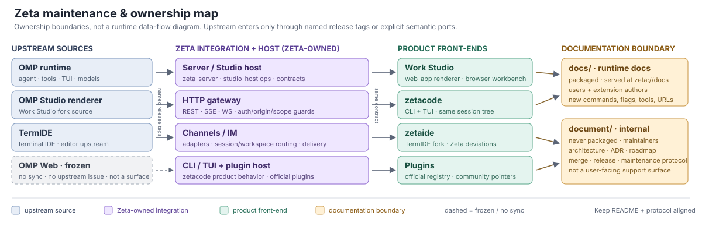

# 维护与归属

[English](ownership.md) · **简体中文**

Zeta 是下游发行版，边界是刻意的：上游缺陷走上游发布流程；Zeta 的产品行为、集成
和使用差异由 Zeta 负责。权威内部协议——问题路由、产品面归属、模块地图与安全
通道——见 [`document/maintenance-ownership.md`](../document/maintenance-ownership.md)。
发布 tag 基线见 [`document/upstream-baselines.md`](../document/upstream-baselines.md)。

## 维护与归属

| 产品面 | 上游 | 维护者 |
| --- | --- | --- |
| `zetacode` 运行时、CLI、TUI | [OMP](https://github.com/can1357/oh-my-pi)，只通过点名的官方 release tag | Zeta 差异由 **Zeta core maintainers** 维护；干净的上游缺陷走上游 |
| Z Work Studio（`web-app/`）、server/Studio host、`/api/v1/*` 与 Web Gateway | OMP Studio 渲染器分支；宿主、契约、网关和分支集成归 Zeta | **Zeta server maintainers** |
| IM（`packages/channels/`、`packages/coding-agent/src/channels/`） | Zeta 原创的频道运行时 | **Zeta IM maintainers** |
| `zetaide` 与编辑器载荷（`termide/`、`editor/`） | [TermIDE](https://github.com/termide/termide)，vendored 分支 | 分支差异与品牌由 **Zeta IDE maintainers** 维护 |
| `desktop/` —— Electron 与浏览器桌面版 | Zeta 原创的桌面打包和外壳 | **Zeta core maintainers** |
| `android/`、`main/` | Zeta 原创；暂停或实验线 | **Zeta core maintainers**；暂停期间不新增产品工作 |
| `plugins/`、`docs/`、`document/`、`rep-docs/` | Zeta 插件注册表与文档面 | **Zeta core maintainers** |
| `web-ui/` | 冻结的 OMP Web 快照 | 无 Zeta 维护者、无同步、不是产品面 |

## 报告路径

按问题复现的位置路由，而不是按代码文件离谁最近路由。

1. **上游缺陷**（不带 Zeta 覆盖层也能复现）→ 上游项目 issue：运行时、TUI、工具与
   模型走 OMP；有干净上游复现的 renderer/host-contract 缺陷走 OMP Studio；终端、
   编辑器、LSP 与 DAP 走 TermIDE。Zeta 只通过下一个**点名的官方 release tag**
   接收修复；绝不合并上游 `main` 或分支，也绝不 cherry-pick 部分 diff。集成的
   运行时源码为 OMP `v18.22.0`。Z Work Studio 的 OMP Studio `v0.2.1` 源码谱系
   已集成，完整验收与 CI 仍待完成；后续 tag 在点名发布同步落地前不集成。
2. **Zeta 功能、使用差异或集成问题** → 本仓库 issue，并按上表找对应维护角色。
   不应要求上游接管我们的产品行为或使用差异。
3. **安全漏洞** → [`.github/SECURITY.md`](../.github/SECURITY.md) 中的私有
   advisory，绝不走公开 issue 或 pull request。IM 与 server 问题一律私有优先。

`zetaide` 与因 Zeta 使用差异新增的 coding-agent 行为由 Zeta 维护，不由上游维护。

## 上游政策

Zeta 只通过完整、官方的发布 tag 跟随 OMP 与 OMP Studio。每次发布都在临时集成
分支上作真实 Git 历史合并，然后以独立提交加入所需的 Zeta 包、品牌、Bun、CI 和
产品适配。确切的来源 tag、SHA、冲突决策和检查记录在
[`document/upstream-sync.md`](../document/upstream-sync.md)。

Pi 是语义功能来源，不是原始合并来源
（[Pi](https://github.com/earendil-works/pi)）。
[Pi Web](https://github.com/agegr/pi-web) 作为 Web 功能的语义来源致谢；
[OMP Web](https://github.com/17380936778/omp-web) 是冻结快照。仓库规则见
[`AGENTS.md`](../AGENTS.md)。

## 组件谱系

| 组件 | 来源 |
| --- | --- |
| `web-app/`（Z Work Studio 渲染器） | Zeta 维护的 OMP Studio 分支（MIT）；`v0.2.1` 源码谱系已集成 |
| `main/`（Rust 工作台，已暂停；`@linxiraos/main`，二进制 `zetawork`/`zeta`） | Zeta 原创；AGPL-3.0-only |
| `packages/coding-agent/`（CLI，`zetacode`） | OMP 运行时树，按发布 tag 合并 |
| `packages/ai`、`agent`、`catalog`、`tui`、`natives`、`utils`、`stats` | OMP 运行时树 |
| `termide/`（TermIDE，`@linxiraos/ide`，二进制 `zetaide`） | [termide/termide](https://github.com/termide/termide)，vendored 分支（此处维护），`0.49.0` |
| `web-ui/` | **已放弃维护**的第三方 OMP Web 快照（`17380936778/omp-web`）；不构建 |
| `desktop/` | Zeta 原创的桌面打包与外壳（Electron 与浏览器版） |
| `packages/coding-agent/src/channels/`（微信/飞书/Telegram 桥接） | Zeta 原创 |
| `packages/coding-agent/src/server/`（web-gateway，`zetacode serve`） | Zeta 原创 |

## 与上游的差异

归属声明只有在边界清楚时才有意义：上游版权声明覆盖上游代码，Zeta 的版权只覆盖
Zeta 修改与新增的部分。按产品面说明：

### `zetacode` —— 编码 Agent 与运行时（源自 OMP）

- **上游**：[OMP](https://github.com/can1357/oh-my-pi)，只在官方发布 tag 上整树
  合并。集成源码为 `v18.22.0`
  （`3e8cff3b7ce19a805c11a26a6dd1703066435851`）：`packages/*`、`crates/*`、
  `sdk/*`、`python/*` 与 TUI。
- **Zeta 的改动**：产品身份（`.zeta`、`zetacode`、`zeta://`、`@linxiraos/*`、
  `zeta-cli-*` 资产名、冻结的启动字符画）；内部 `__zeta*` 记号；用户可见配置使用
  Zeta 名称，已退役的上游配置别名与状态目录不再加载；外来项目配置来源需显式
  同意；工具暴露档位；遥测硬关闭；Zeta 服务端口。
- **运行时之上的 Zeta 功能**（均在 `docs/` 有文档）：`zetacode serve` 与支撑
  Z Work Studio 的 Web Gateway REST 面（[serve](../docs/zeta-serve-web.md)、
  [gateway API](../docs/web-ui/api.md)）；ultra plan
  （[plan approval](../docs/plan-approval.md)）；跨会话项目 tracking
  （[tracking](../docs/zeta-tracking.md)）；频道运行时
  （[channels](../docs/channels.md)）；agent hub 与 mesh
  （[hub](../docs/agent-hub.md)、[mesh](../docs/agent-mesh.md)）；插件注册表
  （[plugins](../docs/plugins.md)）；用量/统计面板；转录分页；静态资源预压缩。
  这些产品面的维护索引是 [`docs/zeta-features.md`](../docs/zeta-features.md)。
- **谁维护**：Zeta。上游只以完整 release tag 合并进入，Zeta 的差异全部是独立提交
  （见 [`document/upstream-sync.md`](../document/upstream-sync.md)）。

### `zetaide` —— 终端 IDE（源自 TermIDE）

- **上游**：[`termide/termide`](https://github.com/termide/termide) tag `0.49.0`
  （`057eb55e0a7c4ee969982fab62dc83bde028e052`），vendored 在 `termide/`，以
  `zetaide` 命令（`@linxiraos/ide`）发布。
- **Zeta 的改动**：本分支、`zetaide` 命令与 npm 打包、编辑器载荷处理、主题与品牌
  适配；逐条差异见 [`termide/VENDOR.md`](../termide/VENDOR.md)。
- **谁维护**：该分支由 Zeta 维护；改动落在这里，不回推上游。

### Z Work Studio —— 浏览器工作台（源自 OMP Studio）

- **上游**：[OMP Studio](https://github.com/the-snowpear/omp-studio) tag `v0.2.1`
  （`6d0b764bb9eac88c1671c0380229823c5630cc74`），MIT。其源码谱系已在此集成；
  完整验收与 CI 仍待完成。
- **Zeta 的改动**：渲染器是 `web-app/` 中由 Zeta 维护的分支（独立 Vite 工程）；
  宿主重写为 `studio-host`（`/api/v1/*` 的 pair、CSRF、query、command、events），
  不再使用上游服务端；client/protocol 面 vendored；品牌收口（Zeta 链接与夹具、
  `zeta-studio` 线协议）；Zeta 新增转录分页、静态资源预压缩、真实插件注册表与
  用量面板。
- **谁维护**：Zeta。改动落在这个分支；不向上游提交，也不自动跟随上游。
- **桌面版**：Electron 与浏览器版是 Zeta 原创的同一渲染器打包。两者都启动独立
  `zetacode serve` 并复用其现有 HTTP 认证；不存在 Rust 桌面 UI。见
  [`docs/desktop-app.md`](../docs/desktop-app.md)。

### `web-ui/` —— 已放弃维护的第三方快照

- **来源**：OMP Web（[`17380936778/omp-web`](https://github.com/17380936778/omp-web)），
  第三方 UI，不由 Zeta 维护。
- **状态**：**已放弃维护**（2026-11-05）。只作为冻结快照保存供参考；不构建、
  不出货、不接收功能或修复，不属于 Zeta 支持面。产品面由 Z Work Studio 取代。

### `zetawork` —— Rust 工作台（Zeta 原创，已暂停）

- **来源**：Zeta 自己的 Rust TUI/GUI 线（`main/`），2026-11-05 暂停；其 npm 包只在
  显式 dispatch 时发布。AGPL-3.0-only。

## 商业面

上游随代码发布自己的商业面：Stencil 构建服务、托管模型目录、托管 `/share`
查看页、自家 Homebrew tap 与 OTLP 遥测。Zeta 一个都不运行：构建服务与遥测不在本
树内；代码仍引用的每个托管端点都钉在
[`document/upstream-commercial-assets.md`](../document/upstream-commercial-assets.md)
并标注替代状态；出现未登记的上游端点时 `bun scripts/check-shared-infra.ts` 会
直接失败。

## 相关仓库

- [Linxira Knowledge Base（`lkb`）](https://github.com/Linxira-OS/linxira-knowledge-base)
  —— 同组织的自托管分层知识库。它提供 MCP server 与 OpenAPI 3.1 接口，Zeta agent
  可作为外部工具查询。它是独立产品、有独立发布线：不随 Zeta 打包，也不是构建
  依赖。客户端边界记录在
  [`document/lkb-integration.md`](../document/lkb-integration.md)。

## 许可证

Zeta 按路径承载两种许可：

| 路径 | 许可 |
| --- | --- |
| `main/` —— 暂停的 Rust 工作台（`zetawork`、`zeta` 及其 npm 包） | **AGPL-3.0-only**（[全文](../main/LICENSE)） |
| `main/` 之外的全部路径 —— 包括 `packages/`、`crates/`、`sdk/`、`web-app/`、`desktop/`、`docs/`、`document/`、`scripts/` 与 `rep-docs/` | **MIT** |
| `termide/`、`editor/` —— vendored TermIDE | **MIT**（[全文](../termide/LICENSE)） |

根目录 [`LICENSE`](../LICENSE) 说明分层，并复述管辖 `main/` 之外全部代码的 MIT
文本。派生与 vendored 项目保持各自许可，列在
[`THIRD-PARTY-NOTICES.txt`](../THIRD-PARTY-NOTICES.txt)。Zeta 的版权行只标注
Zeta 的修改与新增；上游部分仍以上游版权声明与许可文本为准。许可文本不作翻译。

工作台的商业授权可与维护者协商。

Z Work Studio 的编辑器是内置的：`@linxiraos/editor` 是预留给该面板二进制载荷的
包名（早先由 TTT 派生的 Go 载荷已于 2026-10-16 移除，仍在源代码历史中获得
致谢）。

[English](ownership.md) · **简体中文**
